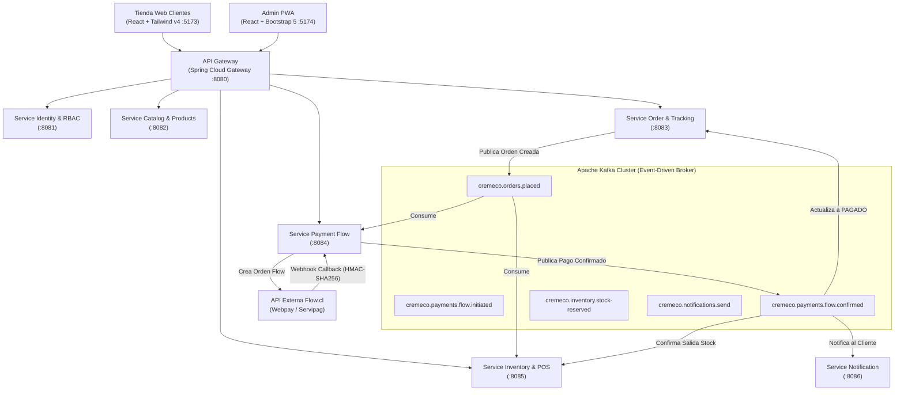
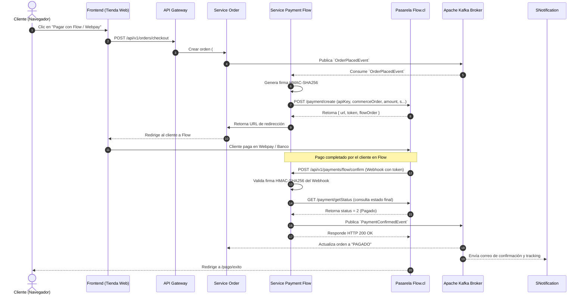

<!-- @pca:start
@id(docs.arquitectura_microservicios_kafka)
@kind(doc)
@limit(lines: 450)
@relates(docs.especificacion_microservicios)
@relates(docs.reglas_backend)
@desc(Arquitectura de microservicios Spring Boot, comunicación asincrónica con Apache Kafka y pasarela de pago Flow)
@pca:end -->

# Arquitectura de Microservicios, Topología Kafka & Pasarela Flow

Este documento define la arquitectura distribuida del backend de **Crème & Co**, la estructura física y lógica de cada microservicio en Spring Boot, la topología de mensajería asincrónica mediante **Apache Kafka** y la integración técnica con la pasarela de pagos chilena **Flow.cl**.

---

## 1. Topología General de Microservicios y Clientes



---

## 2. Estructura de Carpetas del Backend (`backend/`)

El backend está organizado como un sistema modular en Spring Boot 3.3+ y Java 17/21 con Maven:

```
backend/
├── pom.xml                           # POM Padre (gestión de dependencias, Spring Cloud y Kafka)
├── docker-compose.yml                # Infraestructura local: Kafka, Zookeeper/KRaft, MySQL 8, Kafdrop
├── common-events/                    # Librería compartida de eventos Kafka y DTOs
│   ├── pom.xml
│   └── src/main/java/com/cremeco/common/events/
│       ├── OrderPlacedEvent.java
│       ├── PaymentConfirmedEvent.java
│       ├── StockReservedEvent.java
│       └── OrderStatusChangedEvent.java
├── api-gateway/                      # Spring Cloud Gateway (enrutador, CORS y validación JWT)
│   ├── pom.xml
│   └── src/main/resources/application.yml
├── service-identity/                 # Microservicio de Autenticación, Usuarios y Roles RBAC
│   ├── pom.xml
│   └── src/main/java/com/cremeco/identity/
├── service-catalog/                  # Catálogo de tortas, categorías, porciones y disponibilidad
│   ├── pom.xml
│   └── src/main/java/com/cremeco/catalog/
├── service-order/                    # Gestión de pedidos, estados de preparación y tracking #CC-XXXX
│   ├── pom.xml
│   └── src/main/java/com/cremeco/order/
├── service-payment-flow/             # Integración dedicada con la pasarela de pagos Flow.cl
│   ├── pom.xml
│   └── src/main/java/com/cremeco/payment/flow/
│       ├── controller/FlowWebhookController.java
│       ├── service/FlowClientService.java
│       ├── service/FlowSignatureService.java
│       └── kafka/PaymentEventProducer.java
├── service-inventory/                # Control de existencias, Kardex, mermas y caja POS
│   ├── pom.xml
│   └── src/main/java/com/cremeco/inventory/
└── service-notification/             # Consumidor de eventos para emails transaccionales
    ├── pom.xml
    └── src/main/java/com/cremeco/notification/
```

---

## 3. Topología de Comunicación y Tópicos Apache Kafka

Para evitar acoplamientos rígidos y latencia en transacciones financieras, la comunicación entre microservicios se divide en dos capas:

### 3.1. Comunicación Sincrónica (HTTP / REST)
* Utilizada únicamente por **API Gateway** hacia los microservicios para atender peticiones inmediatas del frontend (consultar catálogo, autenticar usuario, consultar saldo de caja).

### 3.2. Comunicación Asincrónica Basada en Eventos (Kafka)
Los flujos de compra, pago y actualización de stock se manejan mediante eventos en Kafka:

| Tópico Kafka | Productor | Consumidores | Payload Clave |
| :--- | :--- | :--- | :--- |
| `cremeco.orders.placed` | `service-order` | `service-inventory`, `service-payment-flow` | `orderId`, `numeroPedido`, `rutCliente`, `totalClp`, `items: [{productoId, cantidad, porcion}]` |
| `cremeco.inventory.stock-reserved` | `service-inventory` | `service-order` | `orderId`, `status: RESERVED/OUT_OF_STOCK`, `insumosBloqueados` |
| `cremeco.payments.flow.initiated` | `service-payment-flow` | `service-order` | `orderId`, `flowOrderToken`, `redirectUrl`, `monto` |
| `cremeco.payments.flow.confirmed` | `service-payment-flow` | `service-order`, `service-inventory`, `service-notification` | `orderId`, `flowOrder`, `paymentDate`, `payerEmail`, `monto`, `metodoPago` |
| `cremeco.payments.flow.failed` | `service-payment-flow` | `service-order`, `service-inventory` | `orderId`, `motivoRechazo` (libera reserva de stock) |
| `cremeco.orders.status-changed` | `service-order` | `service-notification` | `orderId`, `nuevoEstado` (`EN_PREPARACION`, `LISTO_RETIRO`, etc.) |

---

## 4. Especificación Detallada: Microservicio Pasarela Flow (`service-payment-flow`)

Este microservicio encapsula el 100% de la lógica de conexión con **Flow.cl** (soporte para Webpay Plus, Webpay OneClick, Servipag, Multicaja y Mach).

### 4.1. Variables de Entorno Requeridas (Sin Secretos en Código)
```properties
FLOW_API_URL=https://sandbox.flow.cl/api  # En producción: https://www.flow.cl/api
FLOW_API_KEY=${FLOW_API_KEY}              # Clave pública otorgada por Flow
FLOW_SECRET_KEY=${FLOW_SECRET_KEY}        # Clave secreta para generación de firma
FLOW_URL_CONFIRMATION=https://api.cremeco.cl/api/v1/payments/flow/confirm
FLOW_URL_RETURN=https://cremeco.cl/pago/retorno
```

### 4.2. Algoritmo de Firma HMAC-SHA256 de Flow
Flow exige que toda solicitud y webhook valide su integridad mediante una firma criptográfica:
1. Tomar todos los parámetros de la solicitud (excepto la clave `s`).
2. Ordenar las claves alfabéticamente en minúsculas (ej: `amount`, `apiKey`, `commerceOrder`, `currency`, `email`, `subject`, `urlConfirmation`, `urlReturn`).
3. Concatenar `clave` + `valor` sin separadores (ej: `amount34000apiKey...`).
4. Aplicar `HMAC-SHA256` utilizando `FLOW_SECRET_KEY` como llave de firma.
5. Adjuntar el hash hexadecimal resultante en el parámetro `s`.

### 4.3. Flujo Paso a Paso de una Transacción Flow



---

## 5. Infraestructura Local: `docker-compose.yml`

El archivo `backend/docker-compose.yml` levantará los contenedores de soporte:
* **MySQL 8:** Base de datos relacional para entidades de negocio.
* **Apache Kafka + Zookeeper:** Bus de eventos con particiones y replicación local.
* **Kafdrop:** Interfaz web visual en `http://localhost:9000` para monitorear tópicos, mensajes y *offsets*.
* **Redis:** Caché de sesiones y tokens de refresco.
