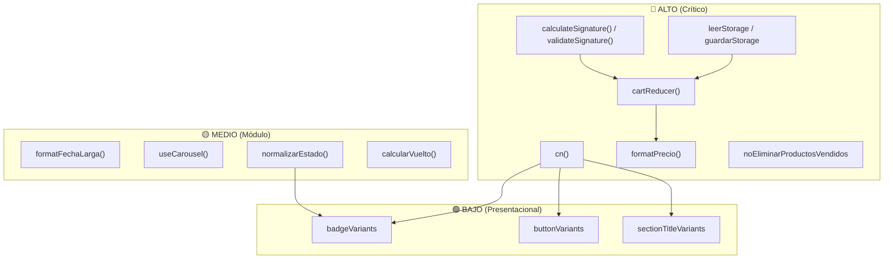

<!-- @pca:start
@id(docs.diccionario_funciones_variables)
@kind(doc)
@limit(lines: 400)
@relates(docs.convenciones)
@relates(docs.reglas_ui)
@relates(docs.arquitectura_microservicios_kafka)
@desc(Diccionario técnico de funciones, variables y matriz de impacto Blast Radius)
@pca:end -->

# Diccionario Técnico de Funciones, Variables y Matriz de Impacto

> **Crème & Co — Arquitectura Fullstack & PWA**  
> **Objetivo:** Registro exhaustivo de funciones y variables del sistema con especificación formal de inputs, outputs, lógica interna y matriz de dependencia/impacto (*Blast Radius*) al ser modificadas.

---

## Convención de Niveles de Impacto (*Blast Radius*)

| Nivel | Significado | Riesgo ante Modificación |
| :---: | :--- | :--- |
| 🔴 **ALTO** | **Núcleo Global / Infraestructura:** Afecta a múltiples capas, contratos de pago, compilación o todo el árbol de render. | Rompe la aplicación completa, fallos silenciosos de cálculo monetario o transacciones financieras inválidas. |
| 🟡 **MEDIO** | **Módulo / Flujo de Dominio:** Afecta a un flujo completo (ej. Carrito, Catálogo, RBAC o Seguimiento). | Inconsistencias en la experiencia del cliente o en la gestión administrativa de la PWA. |
| 🟢 **BAJO** | **Componente Aislado / Presentacional:** Afecta a una sola vista o micro-componente visual. | Desajustes visuales cosméticos sin daño en la lógica de negocio ni persistencia. |

---

## 1. Núcleo de Utilidades y Persistencia (`frontend/src/lib/`)

### 1.1 `cn(...inputs: ClassValue[]): string`
* **Ubicación:** [`frontend/src/lib/utils.ts`](file:///C:/Users/retma/OneDrive/Escritorio/Fullstack2_Proyecto_Pasteleria/frontend/src/lib/utils.ts#L4-L6)
* **Tipo:** Función Pura.
* **Input:**
  - `...inputs: ClassValue[]`: Lista variable de strings, objetos condicionales `{ 'clase': booleano }`, arrays o valores falsy (`undefined`, `null`, `false`).
* **Output:**
  - `string`: Cadena optimizada de clases Tailwind sin colisiones de especificidad CSS.
* **Lógica Interna:**
  1. Evalúa condicionales mediante `clsx(inputs)`, descartando valores falsy.
  2. Pasa el resultado por `twMerge(...)`, el cual analiza el árbol de utilidades de Tailwind CSS y resuelve conflictos de cascada (ej: si coexisten `px-4` y `px-6`, gana `px-6` y se descarta `px-4`).
* **Relaciones:**
  - *Depende de:* `clsx`, `tailwind-merge`.
  - *Consumido por:* Todos los componentes del design system (`Button`, `Card`, `Badge`, `Modal`, `Input`, `SectionTitle`, etc.).
* **Impacto al Modificar:** 🔴 **ALTO (Crítico)**  
  *Justificación:* Cualquier alteración en su resolución rompe la renderización de estilos de toda la interfaz del frontend.

---

### 1.2 `formatPrecio(valor: number): string`
* **Ubicación:** [`frontend/src/lib/utils.ts`](file:///C:/Users/retma/OneDrive/Escritorio/Fullstack2_Proyecto_Pasteleria/frontend/src/lib/utils.ts#L8-L17)
* **Tipo:** Función Pura de Dominio Financiero.
* **Input:**
  - `valor: number`: Monto monetario numérico en Pesos Chilenos (CLP).
* **Output:**
  - `string`: Cadena formateada bajo convención chilena (ej. `"$15.990"`, `"-$5.000"` o `"$0"`).
* **Lógica Interna:**
  1. **Guarda defensiva:** Si `valor` no es `number` o es `NaN`, retorna inmediatamente `"$0"`.
  2. **Redondeo CLP:** Redondea con `Math.round(valor)` para eliminar centavos, ya que el peso chileno no utiliza fracciones decimales en transacciones de consumo.
  3. **Manejo de signos:** Determina si es negativo (`entero < 0`) y aplica formato con separadores de miles mediante `Math.abs(entero).toLocaleString("es-CL")`.
  4. Retorna `-$X.XXX` si es negativo o `$X.XXX` si es positivo.
* **Relaciones:**
  - *Depende de:* `Number.isNaN`, `Math.round`, `Math.abs`, motor nativo `toLocaleString("es-CL")`.
  - *Consumido por:* `ProductCard`, `CartProvider`, `MiniCarrito`, `OrderSummary`, catálogo, vistas de pago y checkout.
* **Impacto al Modificar:** 🔴 **ALTO**  
  *Justificación:* Modificarla impacta directamente en cómo el cliente y el administrador visualizan precios, subtotales, descuentos e IVA. Un error de redondeo puede provocar discrepancias entre la pasarela y la UI.

---

### 1.3 `formatFechaLarga(fecha: string): string`
* **Ubicación:** [`frontend/src/lib/utils.ts`](file:///C:/Users/retma/OneDrive/Escritorio/Fullstack2_Proyecto_Pasteleria/frontend/src/lib/utils.ts#L19-L37)
* **Tipo:** Función Pura de Formateo Temporal.
* **Input:**
  - `fecha: string`: Cadena de fecha en formato ISO (`"YYYY-MM-DD"` o `"YYYY-MM-DDTHH:mm:ssZ"`).
* **Output:**
  - `string`: Cadena legible en español (ej. `"24 de octubre de 2026"`) o `""` si es inválida.
* **Lógica Interna:**
  1. Si `fecha` es vacía o no es string, retorna `""`.
  2. **Prevención de desfase horario (Off-by-one):** Si la fecha coincide con la regex `/^\d{4}-\d{2}-\d{2}$/`, le concatena `T12:00:00` (mediodía) para forzar hora local y neutralizar la conversión a UTC medianoche que restaría un día en Chile (`America/Santiago`, UTC-3/UTC-4).
  3. Valida validez con `Number.isNaN(date.getTime())`.
  4. Formatea con `date.toLocaleDateString("es-CL", { day: "numeric", month: "long", year: "numeric" })`.
* **Relaciones:**
  - *Depende de:* `Date`, `toLocaleDateString`.
  - *Consumido por:* `BlogCard`, `BlogDetalle`, `LineaTiempoPedido`, `PerfilSeguimiento`.
* **Impacto al Modificar:** 🟡 **MEDIO**  
  *Justificación:* Si falla, los posts del blog o los hitos del pedido muestran fechas atrasadas por un día o cadenas vacías.

---

### 1.4 `leerStorage<T>(clave: string, respaldo: T): T` y `guardarStorage<T>(clave: string, valor: T): void`
* **Ubicación:** [`frontend/src/lib/storage.ts`](file:///C:/Users/retma/OneDrive/Escritorio/Fullstack2_Proyecto_Pasteleria/frontend/src/lib/storage.ts#L2-L13)
* **Tipo:** Funciones de Infraestructura y Persistencia.
* **Input:**
  - `leerStorage`: `clave: string`, `respaldo: T` (estado por defecto).
  - `guardarStorage`: `clave: string`, `valor: T` (objeto serializable a JSON).
* **Output:**
  - `leerStorage`: Objeto deserializado de tipo `T` o `respaldo` si falla o no existe.
  - `guardarStorage`: `void`.
* **Lógica Interna:**
  - `leerStorage`: Envuelve `localStorage.getItem` y `JSON.parse` en un bloque `try/catch` seguro contra JSON malformado o navegación privada que bloquee el almacenamiento.
  - `guardarStorage`: Ejecuta `localStorage.setItem(clave, JSON.stringify(valor))`.
* **Relaciones:**
  - *Depende de:* `window.localStorage`, `JSON`.
  - *Consumido por:* `CartProvider` (persistencia del carrito de compras).
* **Impacto al Modificar:** 🔴 **ALTO**  
  *Justificación:* Si se altera la serialización o se rompe el fallback de error, los usuarios pierden su sesión del carrito o la aplicación crashea en modo incógnito.

---

## 2. Gestión de Estado Global del Carrito (`frontend/src/context/`)

### 2.1 Variable de Estado: `CartState`
* **Ubicación:** [`frontend/src/context/CartProvider.tsx`](file:///C:/Users/retma/OneDrive/Escritorio/Fullstack2_Proyecto_Pasteleria/frontend/src/context/CartProvider.tsx#L12-L15)
* **Estructura:**
```typescript
interface CartState {
  items: CartItem[];  // Array de { producto: Producto, cantidad: number }
  cupon: string | null; // Código de cupón activo en mayúsculas
}
```
* **Impacto al Modificar:** 🔴 **ALTO**  
  *Justificación:* Define el contrato de datos del checkout y de toda la experiencia de compra del cliente.

---

### 2.2 Función: `cartReducer(state: CartState, accion: Accion): CartState`
* **Ubicación:** [`frontend/src/context/CartProvider.tsx`](file:///C:/Users/retma/OneDrive/Escritorio/Fullstack2_Proyecto_Pasteleria/frontend/src/context/CartProvider.tsx#L29-L74)
* **Tipo:** Función Pura (Máquina de Estados de Redux/React).
* **Input:**
  - `state: CartState`: Estado actual inmutable.
  - `accion: Accion`: Discriminated Union de acciones:
    - `{ tipo: "agregar", producto: Producto }`
    - `{ tipo: "quitar", productoId: number }`
    - `{ tipo: "cambiarCantidad", productoId: number, cantidad: number }`
    - `{ tipo: "aplicarCupon", cupon: string }`
    - `{ tipo: "quitarCupon" }`
    - `{ tipo: "vaciar" }`
* **Output:**
  - `CartState`: Nuevo objeto de estado inmutable.
* **Lógica Interna:**
  - `"agregar"`: Si el producto ya existe en `items`, incrementa su cantidad con un tope de 99 (`Math.min(99, i.cantidad + 1)`). Si no existe, lo añade con cantidad `1`.
  - `"quitar"`: Filtra excluyendo `productoId`. Si el nuevo array queda vacío (`length === 0`), limpia automáticamente el cupón a `null`.
  - `"cambiarCantidad"`: Si la cantidad solicitada es `<= 0`, remueve el ítem y resetea el cupón si queda vacío. Si es `> 0`, redondea y acota entre 1 y 99 (`Math.min(99, Math.max(1, Math.round(cantidad)))`).
  - `"aplicarCupon"`: Sanitiza con `.trim().toUpperCase()`.
  - `"vaciar"`: Restaura `estadoInicial` (`{ items: [], cupon: null }`).
* **Relaciones:**
  - *Depende de:* Tipos `Producto`, `CartItem`.
  - *Consumido por:* `CartProvider`, `useCart`.
* **Impacto al Modificar:** 🔴 **ALTO (Crítico)**  
  *Justificación:* Toda adición, eliminación o ajuste de cantidad de productos en la tienda pasa por esta función.

---

### 2.3 Variables Computadas del Carrito (`CartProvider`)
* **Ubicación:** [`frontend/src/context/CartProvider.tsx`](file:///C:/Users/retma/OneDrive/Escritorio/Fullstack2_Proyecto_Pasteleria/frontend/src/context/CartProvider.tsx#L81-L91)
* **Variables:**
  1. `subtotal: number`: Suma acumulativa de `precio * cantidad` de todos los items.
  2. `cantidadTotal: number`: Conteo total de unidades físicas en el carrito.
  3. `descuento: number`: Monto en pesos deducido (`Math.round(subtotal * CUPONES[cupon])`). Cero si `subtotal === 0` o no hay cupón.
  4. `envio: number`: Tarifa fija (`ENVIO`) si `items.length > 0`; `0` si está vacío.
  5. `total: number`: `subtotal - descuento + envio`.
* **Impacto al Modificar:** 🔴 **ALTO**  
  *Justificación:* Es el valor final que se envía a la pasarela de pagos (Flow.cl) o al POS. Una discrepancia causaría rechazos de pago o cobros erróneos.

---

## 3. Hooks y Control de Navegación Visual (`frontend/src/hooks/`)

### 3.1 `useCarousel(total: number): UseCarousel`
* **Ubicación:** [`frontend/src/hooks/useCarousel.ts`](file:///C:/Users/retma/OneDrive/Escritorio/Fullstack2_Proyecto_Pasteleria/frontend/src/hooks/useCarousel.ts#L20-L98)
* **Tipo:** Custom React Hook de Sincronización DOM.
* **Input:**
  - `total: number`: Cantidad total de elementos navegables en el carrusel.
* **Output (`UseCarousel`):**
  - `trackRef: React.RefObject<HTMLUListElement>`: Referencia al track con `scroll-snap`.
  - `indice: number`: Posición actual del primer producto visible (base 0).
  - `irA: (destino: number) => void`: Función de navegación directa.
  - `desplazar: (direccion: 1 | -1) => void`: Función para avanzar o retroceder.
* **Lógica Interna:**
  1. **Cálculo de Posiciones:** Mapea el `offsetLeft` relativo de cada elemento marcado con `[data-carrusel-item]`.
  2. **Estrangulamiento con RAF:** El evento `scroll` se sincroniza mediante `requestAnimationFrame` para evitar *layout thrashing* a 60-120 Hz.
  3. **Aritmética Cíclica:** Al avanzar desde el último ítem o retroceder desde el primero, aplica módulo positivo: `((destino % total) + total) % total`.
  4. **Accesibilidad:** Lee `prefers-reduced-motion`; si está activo, realiza scroll `"auto"` en lugar de `"smooth"`.
  5. **Observador de Tamaño:** Utiliza `ResizeObserver` nativo con fallback a `window.resize`.
* **Relaciones:**
  - *Depende de:* DOM API (`scrollTo`, `requestAnimationFrame`, `ResizeObserver`, `matchMedia`).
  - *Consumido por:* `CarouselDestacados.tsx`, banners promocionales.
* **Impacto al Modificar:** 🟡 **MEDIO**  
  *Justificación:* Afecta la fluidez y respuesta táctil del carrusel de productos destacados en la Home.

---

## 4. Lógica de Dominio en Componentes Cliente (`frontend/src/components/domain/`)

### 4.1 `normalizarEstado(raw: string): EstadoPedidoTipo`
* **Ubicación:** [`frontend/src/components/domain/EstadoPedidoBadge.tsx`](file:///C:/Users/retma/OneDrive/Escritorio/Fullstack2_Proyecto_Pasteleria/frontend/src/components/domain/EstadoPedidoBadge.tsx#L38-L50)
* **Tipo:** Función Pura de Mapeo Semántico.
* **Input:**
  - `raw: string`: Cadena cruda del estado emitida por backend o webhook (ej. `"En preparación"`, `"Listo para despacho"`, `"Cancelado"`).
* **Output:**
  - `EstadoPedidoTipo`: Unión estricta: `"pendiente" | "preparacion" | "listo" | "entregado" | "cancelado"`.
* **Lógica Interna:**
  1. Guarda defensiva contra tipos no válidos o vacíos (`return "pendiente"`).
  2. Remueve tildes y diacríticos con `.normalize("NFD").replace(/[\u0300-\u036f]/g, "")` y convierte a minúsculas.
  3. **Jerarquía estricta de evaluación:**
     - 1º Cancelación/Rechazo: `cancel`, `rechaz`, `anul`, `fall` → `"cancelado"`.
     - 2º Finalización: `entreg`, `exit`, `complet`, `finaliz` → `"entregado"`.
     - 3º En camino/Retiro: `listo`, `camin`, `envia`, `despach`, `retiro` → `"listo"`.
     - 4º Cocina: `preparac`, `proces`, `cocin`, `elaborac` → `"preparacion"`.
     - 5º Fallback: `"pendiente"`.
* **Relaciones:**
  - *Depende de:* `estadoPedidoBadgeVariants` (CVA).
  - *Consumido por:* `EstadoPedidoBadge`, `Perfil`, `PerfilSeguimiento`.
* **Impacto al Modificar:** 🟡 **MEDIO**  
  *Justificación:* Afecta la consistencia visual del semáforo de pedidos del cliente en seguimiento y perfil.

---

## 5. Microservicio de Pagos y Seguridad Criptográfica (`backend/service-payment-flow/`)

### 5.1 Variable de Entorno: `secretKey`
* **Ubicación:** [`backend/service-payment-flow/.../FlowSignatureService.java`](file:///C:/Users/retma/OneDrive/Escritorio/Fullstack2_Proyecto_Pasteleria/backend/service-payment-flow/src/main/java/com/cremeco/payment/flow/service/FlowSignatureService.java#L17-L18)
* **Definición:** `@Value("${flow.secret-key}") private String secretKey;`
* **Impacto al Modificar:** 🔴 **ALTO (Crítico de Seguridad)**  
  *Justificación:* Llave secreta compartida con Flow.cl. Si no coincide o se expone, toda la pasarela de pagos queda inhabilitada o vulnerable a suplantación.

---

### 5.2 `calculateSignature(Map<String, String> params): String`
* **Ubicación:** [`backend/service-payment-flow/.../FlowSignatureService.java`](file:///C:/Users/retma/OneDrive/Escritorio/Fullstack2_Proyecto_Pasteleria/backend/service-payment-flow/src/main/java/com/cremeco/payment/flow/service/FlowSignatureService.java#L24-L35)
* **Tipo:** Función Criptográfica HMAC.
* **Input:**
  - `params: Map<String, String>`: Parámetros del pago (monto, orden, comercio, email, urls de retorno).
* **Output:**
  - `String`: Firma hexadecimal en minúsculas generada con algoritmo HMAC-SHA256.
* **Lógica Interna:**
  1. Instancia un `TreeMap<>(params)` para ordenar alfabéticamente las claves de la A a la Z.
  2. Concatena de forma secuencial llave y valor (`key1value1key2value2`), ignorando la clave `"s"` (la firma misma) y valores nulos.
  3. Ejecuta `hmacSha256(toSign.toString(), secretKey)` con codificación UTF-8 estricta.
* **Relaciones:**
  - *Depende de:* `javax.crypto.Mac`, `SecretKeySpec`, `StandardCharsets.UTF_8`.
  - *Consumido por:* `FlowClientService.createPaymentOrder`, `validateSignature`.
* **Impacto al Modificar:** 🔴 **ALTO (Crítico)**  
  *Justificación:* Si el orden o la concatenación varía en un solo caracter o espacio, Flow.cl rechazará la creación del cobro con error `401 Unauthorized` o `Invalid Signature`.

---

### 5.3 `validateSignature(Map<String, String> params, String signatureReceived): boolean`
* **Ubicación:** [`backend/service-payment-flow/.../FlowSignatureService.java`](file:///C:/Users/retma/OneDrive/Escritorio/Fullstack2_Proyecto_Pasteleria/backend/service-payment-flow/src/main/java/com/cremeco/payment/flow/service/FlowSignatureService.java#L40-L46)
* **Tipo:** Función de Verificación de Integridad y Autenticidad.
* **Input:**
  - `params: Map<String, String>`: Parámetros recibidos en el Webhook de Flow.cl.
  - `signatureReceived: String`: Firma enviada por Flow en la cabecera o cuerpo.
* **Output:**
  - `boolean`: `true` si la firma es legítima; `false` si hubo adulteración o falsificación.
* **Lógica Interna:**
  1. Valida que `signatureReceived` no sea nulo ni en blanco.
  2. Calcula la firma esperada localmente con `calculateSignature(params)`.
  3. Compara ambas firmas en tiempo constante (con `MessageDigest.isEqual`) para mitigar vulnerabilidades de ataques de temporización (*timing attacks*).
* **Relaciones:**
  - *Depende de:* `calculateSignature`, `MessageDigest`.
  - *Consumido por:* `FlowWebhookController.handlePaymentNotification`.
* **Impacto al Modificar:** 🔴 **ALTO (Crítico)**  
  *Justificación:* Es la barrera de seguridad contra ataques Man-in-the-Middle o falsificación de pagos confirmados.

---

## 6. Lógica de Administración PWA (`admin-pwa/src/`)

### 6.1 `calcularVuelto(total: number, recibido: number): number`
* **Ubicación:** [`admin-pwa/src/pages/Pos.tsx`](file:///C:/Users/retma/OneDrive/Escritorio/Fullstack2_Proyecto_Pasteleria/admin-pwa/src/pages/Pos.tsx)
* **Tipo:** Función Pura Contable.
* **Input:**
  - `total: number`: Monto final a cobrar.
  - `recibido: number`: Efectivo entregado por el cliente.
* **Output:**
  - `number`: Vuelto a entregar (`Math.max(0, recibido - total)`).
* **Impacto al Modificar:** 🟡 **MEDIO**  
  *Justificación:* Afecta la caja física y cuadratura diaria en el punto de venta de la pastelería.

---

### 6.2 Regla de Integridad de Catálogo: `noEliminarProductosVendidos`
* **Ubicación:** [`admin-pwa/src/pages/Productos.tsx`](file:///C:/Users/retma/OneDrive/Escritorio/Fullstack2_Proyecto_Pasteleria/admin-pwa/src/pages/Productos.tsx)
* **Tipo:** Regla de Negocio / Guard de Eliminación.
* **Input:**
  - `producto: Producto`: Entidad con propiedad `unidadesVendidas: number` (o historial en boletas).
* **Output:**
  - Atributo `disabled` en el botón de eliminar + Tooltip interactivo `"No puedes eliminar productos con ventas históricas registradas"`.
* **Lógica Interna:**
  - Si `producto.ventas > 0`, la UI bloquea la eliminación física (`DELETE`) y solo permite pausar disponibilidad (`desactivar` o cambiar stock a 0) para mantener la integridad referencial de reportes y kardex contable.
* **Impacto al Modificar:** 🔴 **ALTO**  
  *Justificación:* Si se quita esta regla, se violarían las claves foráneas en la base de datos MySQL o se corromperían los informes de ventas históricas.

---

## Matriz Resumen de Dependencias y Grado de Impacto


