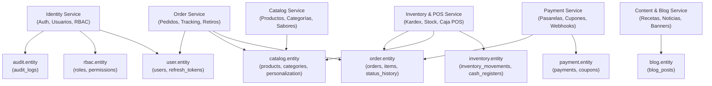

<!-- @pca:start
@id(docs.especificacion_microservicios)
@kind(doc)
@limit(lines: 400)
@relates(docs.reglas_backend)
@relates(interfaces.entity.user)
@relates(interfaces.entity.rbac)
@relates(interfaces.entity.catalog)
@relates(interfaces.entity.order)
@relates(interfaces.entity.payment)
@relates(interfaces.entity.inventory)
@relates(interfaces.entity.blog)
@relates(interfaces.entity.audit)
@desc(Especificación de microservicios y módulos de Spring Boot con sus entidades, endpoints y dependencias)
@pca:end -->

# Especificación de Microservicios y Módulos Backend (Spring Boot)

Este documento define la descomposición modular del backend de **Crème & Co**,
sus dependencias con las entidades de base de datos y los contratos REST expuestos.

---

## Mapa de Módulos y Dependencias

---

## 1. Identity Service (`com.cremeco.pasteleria.identity`)

* **Responsabilidad:** Autenticación de clientes y administradores con JWT, registro, rotación de refresh tokens y control de acceso basado en roles (RBAC).
* **Entidades JPA:** `UserEntity`, `RoleEntity`, `PermissionEntity`, `RefreshTokenEntity`, `AuditLogEntity`.
* **Endpoints principales:**
  * `POST /api/v1/auth/login`: Autentica credenciales y emite access token (15 min) + refresh token opaco (7 días).
  * `POST /api/v1/auth/register`: Registro de nuevo cliente con validación de email único.
  * `POST /api/v1/auth/refresh`: Rota el refresh token y devuelve nuevo JWT.
  * `GET /api/v1/auth/me`: Retorna el perfil y los permisos del usuario logueado.
  * `GET /api/v1/admin/users`: Lista paginada con filtros por estado y rol (`users.read`).
  * `PUT /api/v1/admin/users/{id}/roles`: Asignación de roles con registro en auditoría (`users.manage`).
  * `GET /api/v1/admin/roles/matrix`: Matriz de permisos por módulo (`roles.manage`).

---

## 2. Catalog Service (`com.cremeco.pasteleria.catalog`)

* **Responsabilidad:** Gestión del catálogo de tortas, productos de repostería, categorías y opciones de personalización (bizcochos, rellenos y decoraciones).
* **Entidades JPA:** `CategoryEntity`, `ProductEntity`, `ProductVariationEntity`, `PersonalizationOptionEntity`.
* **Endpoints principales:**
  * `GET /api/v1/catalog/products`: Catálogo público con filtros por categoría, búsqueda, rango de precio y paginación.
  * `GET /api/v1/catalog/products/{slugOrId}`: Detalle de producto con variaciones y stock disponible.
  * `GET /api/v1/catalog/categories`: Lista de categorías activas con orden.
  * `GET /api/v1/catalog/personalization-options`: Opciones disponibles para el configurador de tortas.
  * `POST /api/v1/admin/products`: Creación de producto con imágenes y variantes (`catalog.edit`).
  * `PUT /api/v1/admin/products/{id}`: Actualización de producto (`catalog.edit`).

---

## 3. Order Service (`com.cremeco.pasteleria.orders`)

* **Responsabilidad:** Checkout transaccional con recálculo de precios en servidor, máquina de estados de pedidos, seguimiento paso a paso e información de recogida.
* **Entidades JPA:** `OrderEntity`, `OrderItemEntity`, `OrderStatusHistoryEntity`, `OrderPickupEntity`, `OrderDeliveryAddressEntity`.
* **Estados del Pedido:**
  `PENDIENTE` → `CONFIRMADO` → `EN_PREPARACION` → `LISTO_RETIRO` / `EN_CAMINO` → `ENTREGADO` (o `CANCELADO`).
* **Endpoints principales:**
  * `POST /api/v1/orders`: Creación atómica del pedido con validación de stock y clave de idempotencia (`Idempotency-Key`).
  * `GET /api/v1/orders/{codigoSeguimiento}`: Consulta del seguimiento de pedido y línea de tiempo (público / cliente autenticado).
  * `GET /api/v1/orders/me`: Historial de pedidos del cliente autenticado.
  * `PUT /api/v1/orders/{id}/pickup`: Actualización de la persona designada para el retiro (RUT, nombre y teléfono).
  * `PATCH /api/v1/admin/orders/{id}/status`: Avance de estado en el flujo de cocina/despacho (`orders.manage`).

---

## 4. Payment Service (`com.cremeco.pasteleria.payments`)

* **Responsabilidad:** Orquestación de pasarelas de pago (Transbank Webpay Plus y Flow), validación de firmas criptográficas, confirmación de pagos vía webhooks y administración de cupones de descuento.
* **Entidades JPA:** `PaymentEntity`, `CouponEntity`.
* **Endpoints principales:**
  * `POST /api/v1/payments/init`: Inicia la transacción Webpay y devuelve token + URL de redirección bancaria.
  * `POST /api/v1/payments/transbank/confirm`: Retorno síncrono del cliente tras pagar en Webpay.
  * `POST /api/v1/payments/webhook`: Endpoint seguro asíncrono para confirmación de la pasarela.
  * `POST /api/v1/coupons/validate`: Verifica validez, fechas y monto mínimo de un cupón antes de pagar.
  * `GET /api/v1/admin/coupons`: Administración de cupones y límites de uso (`coupons.manage`).

---

## 5. Inventory & POS Service (`com.cremeco.pasteleria.inventory`)

* **Responsabilidad:** Control estricto de inventario en tiempo real (Kardex), descuento automático de stock tras confirmación de pago, alertas de stock crítico y terminal punto de venta físico con turnos de caja.
* **Entidades JPA:** `InventoryMovementEntity`, `CashRegisterEntity`.
* **Endpoints principales:**
  * `GET /api/v1/inventory/movements`: Registro histórico de entradas, salidas y mermas (`inventory.read`).
  * `POST /api/v1/inventory/adjust`: Ajuste manual de existencias con justificación obligatoria (`inventory.manage`).
  * `POST /api/v1/pos/registers/open`: Apertura de turno de caja con fondo inicial.
  * `POST /api/v1/pos/registers/close`: Arqueo y cierre de caja con cálculo de diferencias.
  * `POST /api/v1/pos/sale`: Venta física presencial con emisión de boleta o ticket.

---

## 6. Content & Blog Service (`com.cremeco.pasteleria.content`)

* **Responsabilidad:** Publicación de artículos editoriales, consejos de repostería, novedades y programación de banners de la tienda online.
* **Entidades JPA:** `BlogPostEntity`.
* **Endpoints principales:**
  * `GET /api/v1/content/posts`: Listado de artículos publicados con filtro por categoría.
  * `GET /api/v1/content/posts/{slug}`: Lectura de artículo completo y artículos relacionados.
  * `POST /api/v1/admin/content/posts`: Creación y edición de artículos (`content.manage`).
