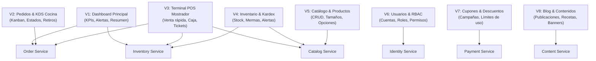

<!-- @pca:start
@id(docs.especificacion_pwa_admin)
@kind(doc)
@limit(lines: 400)
@relates(docs.especificacion_microservicios)
@relates(docs.reglas_ui)
@desc(Especificación de vistas, flujos y permisos de la aplicación PWA de administración)
@pca:end -->

# Especificación de Vistas — PWA de Administración (Admin App)

Este documento especifica la estructura de pantallas, componentes y dependencias de la aplicación **PWA de Administración** de Crème & Co (`admin/`), diseñada para uso en tabletas de mostrador, cocina y escritorio.

---

## Mapa de Vistas y Dependencias hacia Microservicios

---

## 1. V1: Dashboard Principal (`/admin`)

* **Objetivo:** Panel de control de inicio con indicadores en tiempo real de la operación diaria.
* **Componentes clave:**
  * `KpiCard`: Total vendido en el día (CLP), pedidos en cola, entregas pendientes y ticket promedio.
  * `AlertasStockBajo`: Lista de productos o insumos por debajo del umbral mínimo configurado.
  * `UltimosPedidosWidget`: Tabla compacta con los 5 pedidos más recientes y acceso rápido a su detalle.
* **Permiso requerido:** `dashboard.read`.
* **Microservicios consumidos:** `Order Service`, `Inventory Service`.

---

## 2. V2: Gestión de Pedidos & Pantalla de Cocina (`/admin/pedidos`)

* **Objetivo:** Vista para recepción y pastelería con avance rápido de estados en la preparación de tortas.
* **Componentes clave:**
  * `FiltrosEstadoTabs`: Pestañas para `Todos`, `En preparación`, `Listo para retiro`, `Entregados`.
  * `PedidoCard` / `KanbanBoard`: Tarjeta con ID (`#CC-2025-001234`), hora de entrega estimada, detalles de sabor/bizcocho y datos de la persona que retira (RUT y nombre).
  * `BotonTransicionEstado`: Acción directa para pasar un pedido a `LISTO_RETIRO` o `ENTREGADO`, disparando la notificación al tracking del cliente.
* **Permiso requerido:** `orders.manage`.
* **Microservicios consumidos:** `Order Service`.

---

## 3. V3: Punto de Venta POS (`/admin/pos`)

* **Objetivo:** Pantalla táctil de cobro en mostrador físico para retiro de pedidos o venta al paso de repostería.
* **Componentes clave:**
  * `GridProductosRapidos`: Cuadrícula con fotos grandes y botones táctiles por categoría.
  * `CarritoPos`: Resumen lateral del ticket actual con cálculo de subtotales, descuentos y propina voluntaria.
  * `ModalCobro`: Selector de método de pago (Efectivo con cálculo de vuelto, Tarjeta POS Transbank).
  * `ModalCorteCaja`: Apertura matutina con fondo de caja y arqueo de cierre con cálculo de diferencias.
* **Permiso requerido:** `pos.operate`.
* **Microservicios consumidos:** `Inventory & POS Service`, `Catalog Service`, `Order Service`.

---

## 4. V4: Inventario y Movimientos de Stock (`/admin/inventario`)

* **Objetivo:** Control de existencias de productos terminados e insumos críticos para la elaboración.
* **Componentes clave:**
  * `TablaStock`: Listado con semáforo de disponibilidad (verde = normal, amarillo = reabastecer, rojo = agotado).
  * `ModalAjusteStock`: Registro de entradas por compra o salidas por merma/degustación con motivo obligatorio.
  * `HistorialKardex`: Trazabilidad completa de cada movimiento con fecha, usuario responsable y saldo resultante.
* **Permiso requerido:** `inventory.read` / `inventory.manage`.
* **Microservicios consumidos:** `Inventory Service`, `Catalog Service`.

---

## 5. V5: Catálogo y Productos (`/admin/productos`)

* **Objetivo:** Administración de tortas, productos individuales, categorías y precios.
* **Componentes clave:**
  * `FormularioProducto`: Nombre, descripción, precio base CLP, selector de categorías y carga de imagen.
  * `EditorVariaciones`: Tabla dinámica de porciones (10, 15, 20, 25, 30 personas) con su recargo de precio y SKU.
  * `ConfiguradorSabores`: Activación o desactivación de disponibilidad de rellenos (según disponibilidad de cocina).
* **Permiso requerido:** `catalog.edit`.
* **Microservicios consumidos:** `Catalog Service`.

---

## 6. V6: Usuarios, Empleados y Matriz RBAC (`/admin/usuarios`)

* **Objetivo:** Gestión de cuentas de usuario, personal de pastelería y asignación de privilegios.
* **Componentes clave:**
  * `TablaUsuarios`: Lista con búsqueda por nombre/email, badge de estado (Activo/Inactivo) y rol asignado.
  * `ModalAsignarRoles`: Modal para asignar o remover roles de sistema o personalizados.
  * `MatrizPermisosGrid`: Tabla de permisos agrupada por módulo (`orders`, `catalog`, `inventory`, `users`) y acción (`read`, `create`, `update`, `delete`, `manage`).
* **Permiso requerido:** `users.manage` / `roles.manage`.
* **Microservicios consumidos:** `Identity Service`.

---

## 7. V7: Cupones y Promociones (`/admin/cupones`)

* **Objetivo:** Creación y seguimiento de campañas de descuento para marketing.
* **Componentes clave:**
  * `FormularioCupon`: Código promocional, tipo de descuento (porcentaje o monto fijo CLP), fecha de caducidad y límite de usos.
  * `TablaCupones`: Vista de cupones vigentes, porcentaje de uso alcanzado y botón para deshabilitar de inmediato.
* **Permiso requerido:** `coupons.manage`.
* **Microservicios consumidos:** `Payment Service`.

---

## 8. V8: Publicaciones y Blog (`/admin/publicaciones`)

* **Objetivo:** Redacción y programación de artículos del blog y recetas para la tienda online.
* **Componentes clave:**
  * `EditorArticulo`: Título, extracto, editor de contenido por párrafos, tiempo de lectura y categoría.
  * `PublicarSwitch`: Alternar entre borrador y publicado en la tienda.
* **Permiso requerido:** `content.manage`.
* **Microservicios consumidos:** `Content Service`.
