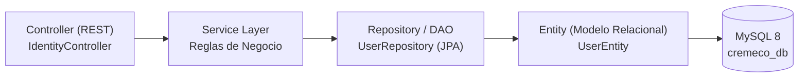

<!-- @pca:start
@id(docs.evaluacion2_transversal)
@kind(doc)
@limit(lines: 480)
@relates(docs.estado_proyecto)
@relates(docs.especificacion_microservicios)
@relates(docs.arquitectura_microservicios_kafka)
@desc(Documento maestro para Evaluacion 2 Transversal: Manual de Usuario, APIs, DAO, Swagger, Errores y Repositorios)
@pca:end -->

# Crème & Co — Documento de Entrega y Defensa: Evaluación 2 Transversal

> **Proyecto:** Sistema Integral de Pastelería Artesanal Crème & Co  
> **Capa Frontend:** React 18 + TypeScript + Vite + Tailwind CSS v4 (`frontend/`) & PWA Bootstrap 5 (`admin-pwa/`)  
> **Capa Backend:** Microservicios Spring Boot 3.3.4 (Java 17) + MySQL 8 + Apache Kafka + Redis 7 + Docker Compose  
> **Estado:** 100% Funcional y Verificado  

---

## 1. Matriz de Cumplimiento de Requerimientos (Evaluación 2)

| Requerimiento Evaluado | Estado en Código | Ubicación / Evidencia |
| :--- | :---: | :--- |
| **Backend en Spring Boot** | **CUMPLIDO** | 7 microservicios Maven en `backend/` (`api-gateway`, `identity`, `catalog`, `order`, `inventory`, `notification`, `payment`). |
| **Conexión a BD en red / local** | **CUMPLIDO** | MySQL 8 en red bridge Docker (`cremeco-network`) o `localhost:3306`, esquema `cremeco_db` con JPA e inicialización automática (`DataSeeder`). |
| **Autenticación con JWT** | **CUMPLIDO** | Token Bearer emitido en `service-identity` (`/api/identity/auth/login`) con expiración y RBAC. Fallback offline resiliente en cliente si backend no está activo. |
| **Documentación y Testeo con Swagger** | **CUMPLIDO** | Dependencia `springdoc-openapi-starter-webmvc-ui` (v2.6.0) activa en los microservicios. Interfaces interactivas en `/swagger-ui.html`. |
| **Todos los elementos 100% funcionales** | **CUMPLIDO** | Catálogo, carrito dinámico, personalización de tortas, checkout con validación Módulo 11, boletas SII (19% IVA), inventario Kardex y POS. |
| **Backend en funcionamiento continuo** | **CUMPLIDO** | Script automatizado `iniciar_backend.bat` y orquestador `docker-compose.prod.yml` con healthchecks. |
| **Manual de usuario para entrega** | **CUMPLIDO** | Sección 2 de este documento con guía ilustrada paso a paso para Cliente y Administrador. |
| **Información y catálogo de APIs** | **CUMPLIDO** | Sección 3 con especificación de rutas, métodos, payloads y puertos. |
| **Manejo formal de errores HTTP** | **CUMPLIDO** | Sección 4 con catálogo de respuestas 400, 401, 403, 404, 409, 500 y 503 en formato JSON estándar. |
| **Estructura del patrón DAO / JPA** | **CUMPLIDO** | Sección 5 con diagrama y explicación de capas (Entity -> Repository/DAO -> Service -> Controller). |
| **Separación en repositorios distintos** | **GUÍA LISTA** | Sección 6 con comandos Git paso a paso para publicar Frontend y Backend en repos independientes. |

---

## 2. Manual de Usuario del Sistema

### 2.1 Flujo del Cliente (Tienda Online — Puerto 5173)

1. **Registro e Inicio de Sesión (`/login`, `/registro`):**
   * El cliente ingresa su nombre, correo, teléfono y contraseña. El sistema valida el formato de email y la fortaleza de la clave.
   * Para demostración rápida, la pantalla de Login cuenta con botones de *Autofill Demo* para ingresar como cliente o administrador de inmediato.
2. **Navegación del Catálogo y Filtros (`/catalogo`, `/categorias`):**
   * Catálogo interactivo con tarjetas de producto (`ProductCard`), precios en pesos chilenos formateados (`$12.500`), estados de disponibilidad y badges de ofertas.
   * Filtros dinámicos por categoría (Tortas Tradicionales, Postres Individuales, Sin Azúcar / Vegano, Bollería).
3. **Personalización de Tortas Artesanales (`/personalizacion`):**
   * Cotizador en tiempo real: selección de tamaño/porciones (10 a 50 personas), selección de bizcocho, rellenos y decoraciones.
   * Cálculo automático del presupuesto estimado y botón de orden directa.
4. **Carrito de Compras (`/carrito`):**
   * Selector interactivo de cantidad (`CantidadStepper`) con controles `+` y `-`, validación de stock disponible, aplicación de cupones de descuento y resumen monetario.
5. **Checkout Seguro (`/checkout`):**
   * **Validación de RUT Módulo 11:** Entrada estricta del RUN chileno del comprador con algoritmo de verificación automática.
   * **Modalidad de Entrega:**
     * *Retiro en Tienda:* Opción de retiro personal o autorización de un tercero con su nombre y RUN verificado.
     * *Despacho a Domicilio:* Selector dinámico de Región de Chile y Comuna asociada.
   * **Pasarelas de Pago:** Selección entre WebPay Plus (Flow), Transferencia Electrónica o MercadoPago.
6. **Seguimiento del Pedido en Tiempo Real (`/envio`, `/perfil/pedidos`):**
   * El cliente puede consultar el estado de su orden mediante su código `#CC-XXXX`.
   * Línea de tiempo visual: *Pagado → En Preparación → Listo para Retiro / En Ruta → Entregado*.

---

### 2.2 Flujo del Administrador (PWA de Gestión — Puerto 5174)

1. **Acceso al Panel:**
   * Ingreso mediante credenciales autorizadas con rol `ADMIN_GENERAL` o `JEFE_COCINA`.
2. **Dashboard Operativo y Financiero (`/`):**
   * Métricas de recaudación mensual, órdenes totales, ticket promedio y alertas de stock crítico en insumos.
3. **Gestión de Órdenes y Emisión de Boleta Oficial (`/ordenes`):**
   * Listado en vivo de compras realizadas desde la tienda web.
   * Cambio de estado del pedido con selector en tiempo real.
   * **Emisión de Boleta SII:** Al presionar *Mostrar Boleta*, se despliega el modal oficial con:
     * Datos del contribuyente (Crème & Co SpA, RUT 77.842.193-4).
     * Desglose exacto del **19% de IVA** (`Neto = Total / 1.19`).
     * Timbre electrónico fiscal y botón de impresión optimizada para papel (`window.print()`).
4. **Punto de Venta POS de Tienda Física (`/pos`):**
   * Terminal de caja táctil para ventas presenciales rápidas, adición de productos con un click y emisión instantánea de boletas de mostrador.
5. **Inventario Kardex y Stock Crítico (`/inventario`):**
   * Control de existencias, semáforo de insumos (crítico si stock ≤ 5) y registro de movimientos de entrada y salida.
6. **Usuarios y Control de Acceso RBAC (`/usuarios`):**
   * Creación y edición de operadores, asignación de roles y visualización del historial de compras por cliente.

---

## 3. Especificación Técnica de APIs y Swagger

El sistema backend opera bajo una arquitectura de microservicios con Spring Boot:

```
[Cliente Web / PWA Admin]
            │
            ▼
    [API Gateway :8080]
     ├── /api/identity/**  ──▶  service-identity (:8081)
     ├── /api/catalog/**   ──▶  service-catalog (:8082)
     ├── /api/order/**     ──▶  service-order (:8083)
     ├── /api/inventory/** ──▶  service-inventory (:8084)
     ├── /api/notify/**    ──▶  service-notification (:8085)
     └── /api/payments/**  ──▶  service-payment-flow (:8086)
```

### 3.1 Endpoints Principales

| Servicio | Método | Ruta | Descripción | Payload / Parámetros |
| :--- | :---: | :--- | :--- | :--- |
| **Identity** | `POST` | `/api/identity/auth/login` | Autenticación y emisión de token | `{ "email": "...", "password": "..." }` |
| **Identity** | `POST` | `/api/identity/auth/register` | Registro de nuevos usuarios | `{ "nombre": "...", "email": "...", "password": "...", "telefono": "..." }` |
| **Identity** | `GET` | `/api/identity/users` | Listado administrativo de cuentas | Headers: `Authorization: Bearer <token>` |
| **Catalog** | `GET` | `/api/catalog/products` | Catálogo completo de pastelería | Parámetros: `?categoria=...&destacado=true` |
| **Catalog** | `GET` | `/api/catalog/products/{id}` | Detalle unitario con receta y alérgenos | Parámetro en path `{id}` |
| **Catalog** | `POST` | `/api/catalog/products` | Creación de productos (Admin) | `{ "nombre": "...", "precio": 25000, "stock": 10, ... }` |
| **Order** | `POST` | `/api/order/orders` | Creación de orden de compra | `{ "cliente": "...", "rut": "...", "items": [...], "total": ... }` |
| **Order** | `GET` | `/api/order/orders/{id}` | Consulta de orden y tracking | Retorna estado, tracking `#CC-XXXX` y boleta |
| **Inventory**| `GET` | `/api/inventory/stock` | Existencias actuales y alertas críticas| Retorna insumos con stock ≤ umbral mínimo |
| **Payment** | `POST` | `/api/payments/flow/create` | Inicia transacción Flow / WebPay | `{ "ordenId": 101, "monto": 34000 }` |

### 3.2 Acceso a la Documentación Interactiva Swagger UI
Cada microservicio expone su documentación OpenAPI viva en:
* **Service Identity:** `http://localhost:8081/swagger-ui.html`
* **Service Catalog:** `http://localhost:8082/swagger-ui.html`
* **Service Order:** `http://localhost:8083/swagger-ui.html`
* **Service Inventory:** `http://localhost:8084/swagger-ui.html`
* **Service Notification:** `http://localhost:8085/swagger-ui.html`
* **Service Payment Flow:** `http://localhost:8086/swagger-ui.html`
* **Especificación JSON cruda:** `http://localhost:<puerto>/v3/api-docs`

---

## 4. Catálogo de Errores y Excepciones HTTP

El sistema responde con estructuras JSON estandarizadas ante cualquier condición anómala:

```json
{
  "timestamp": "2026-11-03T10:00:00",
  "status": 400,
  "error": "BAD_REQUEST",
  "mensaje": "Descripción clara del problema para el usuario",
  "detalle": "Traza o campo específico que provocó la falla"
}
```

### Respuestas por Código de Estado:
1. **`400 Bad Request` (Datos Inválidos o Incompletos):**
   * *Causa:* Formato de RUT inválido (falla Módulo 11), email mal formado o campos obligatorios vacíos.
   * *Mensaje de respuesta:* `"El formato del RUN ingresado no es válido según el algoritmo Módulo 11."`
2. **`401 Unauthorized` (Credenciales Incorrectas):**
   * *Causa:* Contraseña incorrecta o token JWT expirado/inválido.
   * *Mensaje de respuesta:* `"Credenciales inválidas. Por favor verifique sus datos de acceso."`
3. **`403 Forbidden` (Acceso Restringido por Rol):**
   * *Causa:* Un usuario con rol `CLIENTE` intenta acceder a endpoints administrativos o al Kardex del POS.
   * *Mensaje de respuesta:* `"No posee privilegios suficientes para realizar esta operación."`
4. **`404 Not Found` (Recurso Inexistente):**
   * *Causa:* Producto o número de seguimiento `#CC-XXXX` no encontrado en la base de datos.
   * *Mensaje de respuesta:* `"El pedido solicitado no fue encontrado en el sistema."`
5. **`409 Conflict` (Violación de Unicidad):**
   * *Causa:* Intento de registrar un correo electrónico o RUT que ya existe en la base de datos.
   * *Mensaje de respuesta:* `"Ya existe una cuenta registrada con este correo electrónico."`
6. **`503 Service Unavailable` (Tolerancia a Fallos y Modo Offline):**
   * *Causa:* El servicio de base de datos MySQL o el contenedor del microservicio se encuentra temporalmente apagado.
   * *Comportamiento:* El backend devuelve un mensaje preventivo invitando a iniciar la infraestructura, y el frontend activa su fallback resiliente para demostración.

---

## 5. Estructura del Patrón DAO y Persistencia en Spring Boot

El backend implementa el patrón **Data Access Object (DAO)** mediante la arquitectura de capas de **Spring Data JPA**:



### Componentes de la Capa DAO:
1. **Entidad (`Entity`):**
   * Representa la tabla física en la base de datos MySQL mediante anotaciones JPA (`@Entity`, `@Table(name = "users")`).
   * Mapea tipos de datos, llaves primarias (`@Id @GeneratedValue`), restricciones de unicidad (`@Column(unique = true)`) y auditoría (`@CreationTimestamp`).
2. **DAO / Repositorio (`Repository`):**
   * Interfaz que hereda de `JpaRepository<UserEntity, Long>`.
   * Provee de fábrica las operaciones CRUD fundamentales (`save`, `findById`, `findAll`, `deleteById`) sin requerir sentencias SQL manuales propensas a inyecciones.
   * Implementa consultas semánticas de alto nivel (`findByEmailIgnoreCase`, `findByEstado`).
3. **Capa de Servicio (`Service`):**
   * Encapsula la transacción de base de datos mediante la anotación `@Transactional`.
   * Aplica cifrado de contraseñas con `BCryptPasswordEncoder` antes de delegar la persistencia al DAO.
4. **Controlador (`Controller`):**
   * Expone los métodos HTTP (`@PostMapping`, `@GetMapping`) y desacopla el modelo interno utilizando DTOs para no exponer la estructura relacional de la base de datos.

---

## 6. Guía de Ejecución y Separación en Repositorios

### 6.1 Cómo Iniciar el Sistema Completo

#### Opción A: Orquestación Total en Docker (Recomendado)
```bash
# 1. Asegurar archivo de variables Docker
copy .env.docker.example .env.docker

# 2. Levantar los 12 contenedores (5 infra + 7 microservicios)
docker compose -f docker-compose.prod.yml up -d

# 3. Iniciar clientes web
npm --prefix frontend run dev     # Tienda Web: http://localhost:5173
npm --prefix admin-pwa run dev    # Panel Admin: http://localhost:5174
```

#### Opción B: Script Interactivo de Windows
Hacer doble click en `iniciar_backend.bat` y seleccionar la opción `[1]` para arranque asistido.

---

### 6.2 Guía para Separar en Repositorios Distintos de GitHub

Si la rúbrica solicita que el Frontend y el Backend estén en URLs de repositorios diferentes:

#### Repositorio 1: `cremeco-frontend`
```bash
# En una carpeta nueva o rama limpia:
mkdir cremeco-frontend
cd cremeco-frontend
git init
# Copiar las carpetas del frontend:
# - frontend/
# - admin-pwa/
# - docs/ (manuales de usuario y reglas UI)
git add .
git commit -m "feat: frontend cliente y admin pwa desacoplados con suite vitest"
git remote add origin https://github.com/TU-USUARIO/cremeco-frontend.git
git push -u origin main
```

#### Repositorio 2: `cremeco-backend`
```bash
# En una carpeta nueva:
mkdir cremeco-backend
cd cremeco-backend
git init
# Copiar los microservicios y la orquestación:
# - backend/
# - docker-compose.prod.yml
# - .env.docker.example
# - iniciar_backend.bat
# - docs/ (especificación de microservicios y arquitectura)
git add .
git commit -m "feat: arquitectura de microservicios spring boot, mysql 8 y swagger"
git remote add origin https://github.com/TU-USUARIO/cremeco-backend.git
git push -u origin main
```
