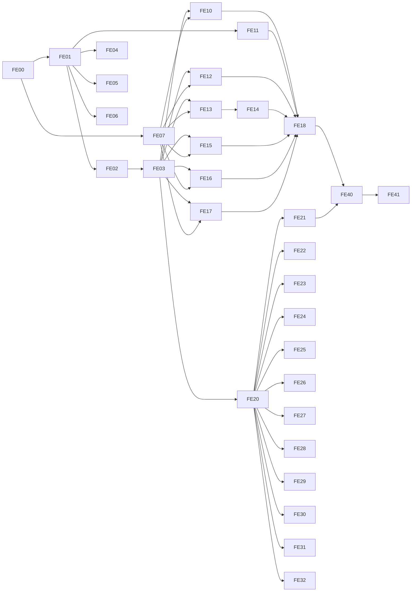

<!-- @pca:start
@id(docs.plan_frontend_first)
@kind(doc)
@limit(lines: 260)
@relates(docs.plan_sprints, docs.backlog_requisitos, docs.estado_proyecto, docs.git)
@desc(Ola Frontend-first: tablero FE-xx, dependencias, carriles paralelos y decisiones)
@pca:end -->

# Ola Frontend-first (FE-00 → FE-41)

> **Fase:** F2 — Plan de Sprints · **Estado:** En revisión (requiere "aprobado")
> **Precede a:** el plan backend T21–T88 de [`plan_sprints.md`](./plan_sprints.md), que se mantiene.
> **Tickets detallados:** [`docs/tickets/fe-*.md`](./tickets/)

## 1. Por qué esta ola

El backend (Spring Boot + MySQL) aún no empieza. Terminar **primero** la tienda y la PWA
de administración contra una **capa de servicios tipada con implementaciones mock**
permite:

1. Separar estética de reglas de negocio: los componentes solo conocen interfaces.
2. Que las interfaces de `packages/contracts` sean el **borrador del contrato REST** que
   luego implementa Spring (FE-41 lo convierte en `docs/contrato_api.md`).
3. Reemplazar el mock por un cliente HTTP real sin tocar páginas (solo el provider).

## 2. Decisiones aprobadas (2026-10-24)

| # | Decisión |
| :--- | :--- |
| D1 | El plan T21–T88 se conserva para el backend; esta ola va antes con prefijo `FE-xx`. |
| D2 | PWA admin = app separada `admin/` con **Vite + React + TS + Tailwind v4 + CVA** (reemplaza "Bootstrap 5" de RF-007/T27). |
| D3 | npm workspaces en la raíz: `frontend/`, `admin/`, `packages/ui`, `packages/contracts`, `packages/mock-api`. |
| D4 | Datos: interfaces en `packages/contracts`; mocks en `packages/mock-api` (memoria + `localStorage` versionado, latencia y errores simulables). |
| D5 | Módulos admin: auth, usuarios, roles/permisos, inventario, productos/categorías, publicaciones, descuentos/cupones, POS, pedidos, dashboard, configuración. |
| D6 | Equipo: el alumno + agentes de IA en paralelo (un agente = un carril = una rama/worktree). |
| D7 | T16, T17, T18 y T19 quedan absorbidos por FE-10, FE-11, FE-12 y FE-18. |

> [!WARNING]
> **Limitación conocida del mock:** `frontend` (5173) y `admin` (5174) son orígenes distintos,
> así que **no comparten `localStorage`**. Ambas apps arrancan con las mismas semillas, pero lo
> que se cree en el admin no aparece en la tienda hasta que exista el backend. Es aceptado.

## 3. Arquitectura objetivo

```text
packages/
  ui/          tokens @theme + primitivas CVA (Button, Input, DataTable, ...)
  contracts/   tipos de dominio, catálogo de permisos, interfaces *Service, ApiError, Page<T>
  mock-api/    createMockApi(): implementa todas las interfaces + semillas
frontend/      tienda (consume ServicesProvider → mock hoy, HTTP mañana)
admin/         PWA (idem) + vite-plugin-pwa
```

Regla de capas: `pages → components → hooks → services (contracts)`. Una página **nunca**
importa de `mock-api` ni de `data/`; solo usa `useServices()`.

## 4. Tablero

Estados: `Pendiente` · `En curso` · `En revisión` · `Hecho` · `Bloqueado`.

### Ola A — Fundaciones (ruta crítica)

| ID | Título | Depende de | Estado |
| :--- | :--- | :--- | :--- |
| FE-00 | Estabilizar build (`asChild` → `ButtonLink`, lint) y commitear trabajo pendiente | — | Pendiente |
| FE-01 | npm workspaces + `packages/ui` (tokens y primitivas existentes) | FE-00 | Pendiente |
| FE-02 | `packages/contracts`: dominio, permisos, interfaces de servicio, errores | FE-01 | Pendiente |
| FE-03 | `packages/mock-api`: infraestructura, stubs por servicio, semillas, `ServicesProvider` | FE-02 | Pendiente |
| FE-04 | Primitivas de formulario (Select, Textarea, Checkbox, Switch, RadioGroup, FormField) | FE-01 | Pendiente |
| FE-05 | Primitivas de datos y feedback (DataTable, Pagination, Tabs, ConfirmDialog, Toast, Drawer, Dropdown, Skeleton) | FE-01 | Pendiente |
| FE-06 | Infra de pruebas: Vitest + Testing Library en packages y apps | FE-01 | Pendiente |
| FE-07 | Rutas de la tienda con lazy-loading y páginas stub (congela `App.tsx`) | FE-00 | Pendiente |

### Ola B — Tienda cliente (Carril 1)

| ID | Título | Depende de | Estado |
| :--- | :--- | :--- | :--- |
| FE-10 | Catálogo al design system + `catalogService` (filtros, búsqueda, paginación) | FE-03, FE-04, FE-07 | Pendiente |
| FE-11 | Navbar y Footer al design system | FE-01 | Pendiente |
| FE-12 | ProductoDetalle completo con servicio (variaciones, no disponible, relacionados) | FE-03, FE-07 | Pendiente |
| FE-13 | Login y Registro (páginas + `AuthProvider` sobre `authService`) | FE-03, FE-04, FE-07 | Pendiente |
| FE-14 | Perfil: datos, direcciones, historial de pedidos | FE-13 | Pendiente |
| FE-15 | Seguimiento de envío | FE-03, FE-07 | Pendiente |
| FE-16 | Carrito + Checkout + cupón + confirmación/pago contra servicios | FE-03, FE-04, FE-07 | Pendiente |
| FE-17 | Blog y publicaciones de Home (banners/destacados) desde `publicationService` | FE-03, FE-07 | Pendiente |
| FE-18 | Eliminar `src/mockup/`, página 404 y repaso SEO/a11y | FE-10…FE-17 | Pendiente |

### Ola C — PWA de administración

| ID | Título | Carril | Depende de | Estado |
| :--- | :--- | :--- | :--- | :--- |
| FE-20 | Scaffold `admin/`: Vite + PWA + layout (sidebar/bottom-nav) + rutas stub + mover POS | 2 | FE-01, FE-03 | Pendiente |
| FE-21 | Auth admin: login, sesión, `RequirePermission`, `usePermission`, menú por permisos | 2 | FE-20 | Pendiente |
| FE-22 | Usuarios: CRUD, activar/desactivar, reset, asignar roles, salvaguardas | 2 | FE-20, FE-04, FE-05 | Pendiente |
| FE-23 | Roles y matriz de permisos (módulo × acción) | 2 | FE-20, FE-04, FE-05 | Pendiente |
| FE-24 | Productos y categorías: CRUD, variaciones, imágenes, borrador/publicado, destacado | 3 | FE-20, FE-04, FE-05 | Pendiente |
| FE-25 | Inventario: stock, movimientos, alertas de stock bajo | 3 | FE-20, FE-04, FE-05 | Pendiente |
| FE-26 | Publicaciones web: banners de Home, destacados y blog (CRUD + programación) | 3 | FE-20, FE-04, FE-05 | Pendiente |
| FE-27 | Descuentos y cupones | 3 | FE-20, FE-04, FE-05 | Pendiente |
| FE-28 | Pedidos: lista, filtros, detalle, máquina de estados | 4 | FE-20, FE-05 | Pendiente |
| FE-29 | POS al design system + servicio + apertura/cierre de caja | 4 | FE-20, FE-05 | Pendiente |
| FE-30 | Dashboard de KPIs | 4 | FE-20, FE-05 | Pendiente |
| FE-31 | Configuración de tienda (datos, horarios, parámetros) | 4 | FE-20, FE-04 | Pendiente |
| FE-32 | PWA offline: shell offline, indicador de conexión, prompt de instalación | 4 | FE-20 | Pendiente |

### Ola D — Calidad y traspaso al backend

| ID | Título | Depende de | Estado |
| :--- | :--- | :--- | :--- |
| FE-40 | E2E con Playwright: compra, login admin, CRUD producto, permisos | FE-18, FE-21…FE-27 | Pendiente |
| FE-41 | `docs/contrato_api.md` desde los contratos + actualizar backlog (RF-007) y T21–T88 | Ola B y C | Pendiente |

## 5. Grafo de dependencias



## 6. Carriles para trabajo en paralelo

| Momento | Carril 1 (Tienda) | Carril 2 (Identidad) | Carril 3 (Comercio) | Carril 4 (Operación) |
| :--- | :--- | :--- | :--- | :--- |
| Ola A | FE-00 → FE-07 | FE-01 → FE-02 → FE-03 | FE-04 | FE-05, FE-06 |
| Ola B/C | FE-10…FE-17 | FE-20 → FE-21 → FE-22, FE-23 | FE-24…FE-27 | FE-28…FE-32 |
| Cierre | FE-18 | FE-40 | — | FE-41 |

## 7. Reglas de paralelización

1. **Archivos congelados:** `frontend/src/App.tsx` (FE-07) y `admin/src/App.tsx` (FE-20) se
   escriben una vez con todas las rutas y páginas stub. Los tickets de página solo editan **su**
   carpeta `pages/<modulo>/`.
2. **Un archivo por servicio:** FE-03 crea `packages/mock-api/src/services/<x>.mock.ts` como
   stub; cada ticket de módulo implementa solo el suyo. Los barrels `index.ts` no se tocan.
3. **Contratos:** si un ticket necesita cambiar una interfaz de `packages/contracts`, lo declara
   en su sección *Contrato* y se integra antes que los demás (merge pequeño y temprano).
4. **Compartidos al integrar:** `tools/pca.config.json`, `docs/estado_proyecto.md` y
   `package-lock.json` los actualiza quien integra a `develop`, no cada rama.
5. **Ramas:** `feature/FE-xx-<descripcion>` desde `develop`; un worktree por agente.
6. **Verde antes de integrar:** `npm run lint`, `npm run build` y `npm test` en el workspace.

## 8. Preguntas abiertas (se resuelven antes de iniciar el ticket indicado)

| Ticket | Pregunta |
| :--- | :--- |
| FE-02 | Lista final de módulos × acciones del catálogo de permisos (propuesta en el ticket). |
| FE-25 | ¿Incluir insumos y recetas (RF-041/042) o solo stock de producto terminado? |
| FE-27 | ¿Los descuentos se acumulan (oferta de producto + cupón)? ¿Un cupón por pedido? |
| FE-24 | Imágenes en modo mock: ¿data-URL en `localStorage` (límite ~5 MB) o solo URLs? |
| FE-16 | Medios de pago a simular y reglas de envío (zonas/tarifas) en esta ola. |
| FE-28 | Estados exactos del pedido y transiciones permitidas por rol. |
