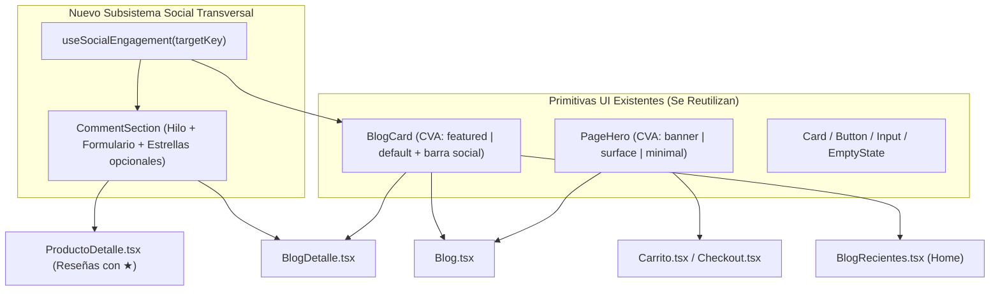

<!-- @pca:start
@id(docs.tickets.s14)
@kind(doc)
@limit(lines: 360)
@relates(docs.plantilla_ticket, docs.estado_proyecto, docs.reglas_ui)
@desc(Tickets T133 a T137 del Sprint 14: subsistema social reutilizable, BlogCard/PageHero unificados y cohesion cromatica)
@pca:end -->

# Sprint 14 — Subsistema Social Reutilizable (Comentarios, Likes y Reseñas) y Cohesión Visual del Design System (`frontend/`)

> **Fase:** F4 — Validación / Testing & Arquitectura de Componentes Reutilizables
> **Rango de tickets:** `T133` – `T137`
> **Objetivo:** Evitar la duplicación de código creando subsistemas transversales y reutilizando los componentes ya existentes (`BlogCard`, `PageHero`, `Card`, `Button`, `Input`, `EmptyState`) para dotar a `Blog`, `BlogDetalle`, `BlogRecientes` y `ProductoDetalle` de un sistema real de comentarios, likes, guardados y calificaciones, y unificar el uso de colores y cabeceras en `Carrito`, `Checkout`, `Login` y `Registro`.

---

## Arquitectura de Subsistemas y Reutilización

---

## T133 — Subsistema transversal de interacciones y comentarios (`useSocialEngagement` + `CommentSection`)

- **ID:** `T133`
- **Fase / Sprint:** `F4` / `S14`
- **Estado:** `Completado`
- **Rama sugerida:** `feature/T117-catalogo-fase-categorias`

### 1. Contexto (Por qué)
Tanto los artículos del blog (`Blog.tsx`, `BlogDetalle.tsx`) como las fichas de productos (`ProductoDetalle.tsx`) requieren reacciones (Me gusta, Guardar/Favorito, Compartir) y un sistema real de comentarios/reseñas donde el cliente pueda leer opiniones previas, publicar la suya (pre-llenando su nombre desde `useAuth()`), calificar con estrellas opcionales (`1–5 ★`), dar "Me gusta" a comentarios individuales o eliminar su propio comentario. Construirlo como un subsistema único evita duplicar lógica de almacenamiento y UI entre Blog y Catálogo.

### 2. Alcance y archivos a tocar (A qué)
| Acción | Archivo | `@id` PCA | Límite (`@limit`) |
| :--- | :--- | :--- | :--- |
| Crear | `frontend/src/hooks/useSocialEngagement.ts` | `frontend.hooks.useSocialEngagement` | 220 |
| Crear | `frontend/src/components/domain/CommentSection.tsx` | `frontend.domain.commentSection` | 220 |

### 3. Especificación técnica (Cómo)
1. **`useSocialEngagement(targetKey: string, initialCounts?: { likes?: number; saves?: number })`:**
   - Gestiona en `localStorage` (`pasteleria_social_v1`) y sincroniza entre componentes (vía evento custom `cremeco:social-updated` en `window`) el estado para cualquier `targetKey` (ej. `"blog:secretos-del-bizcocho-esponjoso"` o `"product:1"`):
     - `liked: boolean`, `saved: boolean`, `likesCount: number`, `savesCount: number`, `comments: SocialComment[]`.
     - Acciones: `toggleLike()`, `toggleSave()`, `addComment({ autor, texto, rating? })`, `toggleCommentLike(commentId)`, `deleteComment(commentId)`.
   - Incluye semilla inicial realista de comentarios artesanales para los artículos del blog y productos destacados.
2. **`CommentSection.tsx`:**
   - Reutiliza `Card`, `Button`, `Input` y `EmptyState` del design system.
   - Si recibe `allowRating?: boolean`, muestra selector interactivo de `1` a `5` estrellas (`Star` de `lucide-react`) y el promedio general.
   - Si el usuario está autenticado (`useAuth()`), pre-rellena automáticamente su nombre y muestra badge `"Cliente Verificado"`.

### 4. Casos límite (Edge Cases)
- **Comentario vacío o solo espacios:** Validación que impide publicar textos menores a 3 caracteres.
- **Sincronización instantánea:** Al agregar un comentario en `BlogDetalle`, el contador de comentarios en `BlogCard` se actualiza automáticamente.

### 5. Convenciones aplicables
- `docs/reglas_ui.md`: Uso estricto de tokens (`primary`, `secondary`, `tertiary`, `neutral`, `ink`) y primitivas de `components/ui/`.

### 6. Definition of Done (DoD)
- [ ] `useSocialEngagement` persiste y sincroniza likes, guardados y comentarios por `targetKey`.
- [ ] `CommentSection` permite publicar, calificar (opcional), dar like a comentarios y eliminar los propios.

---

## T134 — Evolución de `BlogCard` y rediseño editorial de `Blog.tsx`, `BlogDetalle.tsx` y `BlogRecientes.tsx`

- **ID:** `T134`
- **Fase / Sprint:** `F4` / `S14`
- **Estado:** `Completado`
- **Rama sugerida:** `feature/T117-catalogo-fase-categorias`
- **Depende de:** `T133`

### 1. Contexto (Por qué)
1. El componente [`BlogCard.tsx`](../../frontend/src/components/domain/BlogCard.tsx) ya existe en el proyecto con variantes CVA `default` y `featured`, pero `Blog.tsx` y `BlogRecientes.tsx` no lo estaban reutilizando: `Blog.tsx` renderizaba filas planas sobre fondo crema sin tarjetas y `BlogRecientes.tsx` en la Home ni siquiera mostraba las fotos de los artículos.
2. `BlogDetalle.tsx` mostraba párrafos sueltos sobre el fondo crema sin tarjeta editorial blanca, sin barra de reacciones (Like / Guardar / Compartir) y sin sección de comentarios.

### 2. Alcance y archivos a tocar (A qué)
| Acción | Archivo | `@id` PCA | Límite (`@limit`) |
| :--- | :--- | :--- | :--- |
| Modificar | `frontend/src/components/domain/BlogCard.tsx` | `frontend.components.domain.blogcard` | 200 |
| Modificar | `frontend/src/components/domain/BlogRecientes.tsx` | `frontend.domain.blogRecientes` | 80 |
| Modificar | `frontend/src/pages/Blog.tsx` | `frontend.page.blog` | 240 |
| Modificar | `frontend/src/pages/BlogDetalle.tsx` | `frontend.page.blogDetalle` | 240 |

### 3. Especificación técnica (Cómo)
1. **En `BlogCard.tsx`:**
   - Conectar `useSocialEngagement(\`blog:\${post.slug}\`)` para mostrar e interactuar directamente con el botón de **Me gusta (`Heart`)**, **Guardar receta (`Bookmark`)**, **Contador real de comentarios (`MessageCircle`)** y **Compartir (`Share2`)** en el pie de cada tarjeta.
2. **En `Blog.tsx`:**
   - Usar `PageHero` (`variant="banner"`) con la estética cálida de la marca (`from-tertiary via-ink to-secondary`), filtros por categoría con contadores y banner lateral/superior de promoción.
   - Renderizar el artículo principal con `<BlogCard post={destacado} variant="featured" />` y el resto en grilla de tarjetas `<BlogCard post={post} />`, más `<EmptyState />` si no hay coincidencias.
3. **En `BlogDetalle.tsx`:**
   - Envolver el artículo en una tarjeta editorial blanca (`Card`), estilizar los pasos numerados (`1. ...`, `2. ...`) como bloques destacados con insignia `secondary`/`primary`, añadir la barra interactiva de Likes + Guardados + Compartir sincronizada con `useSocialEngagement` e integrar `<CommentSection targetKey={\`blog:\${post.slug}\`} />` al final del artículo.
4. **En `BlogRecientes.tsx` (Home):**
   - Reutilizar `blogPosts.slice(0, 3)` y `<BlogCard />` para que la Home muestre tarjetas visuales con imagen, categoría, likes y comentarios reales.

### 4. Casos límite (Edge Cases)
- **Imágenes con error de carga:** Fallback automático a `/imagen/torta.jpg`.
- **Sincronización Home ↔ Blog ↔ BlogDetalle:** Dar like o comentar en `BlogDetalle` se refleja al volver a `/blog` o `/`.

### 5. Convenciones aplicables
- `docs/reglas_ui.md`: Reutilización obligatoria de componentes de dominio existentes (`BlogCard`, `PageHero`, `EmptyState`).

### 6. Definition of Done (DoD)
- [ ] `Blog.tsx`, `BlogDetalle.tsx` y `BlogRecientes.tsx` reutilizan `BlogCard`.
- [ ] `BlogDetalle.tsx` cuenta con tarjeta editorial, pasos destacados, barra de likes/guardados y sistema completo de comentarios (`CommentSection`).

---

## T135 — Atributos artesanales y Reseñas con Calificación en `ProductoDetalle.tsx`

- **ID:** `T135`
- **Fase / Sprint:** `F4` / `S14`
- **Estado:** `Completado`
- **Rama sugerida:** `feature/T117-catalogo-fase-categorias`
- **Depende de:** `T133`

### 1. Contexto (Por qué)
En [`ProductoDetalle.tsx`](../../frontend/src/pages/ProductoDetalle.tsx), la ficha del producto desaprovecha el espacio inferior derecho con una lista plana de 3 viñetas y carece de valoraciones de clientes. Reutilizando `CommentSection` (con `allowRating={true}`) y estructurando tarjetas de sellos artesanales con la paleta `primary`/`secondary`/`tertiary`, la ficha gana jerarquía visual y prueba social real.

### 2. Alcance y archivos a tocar (A qué)
| Acción | Archivo | `@id` PCA | Límite (`@limit`) |
| :--- | :--- | :--- | :--- |
| Modificar | `frontend/src/pages/ProductoDetalle.tsx` | `frontend.page.productoDetalle` | 320 |

### 3. Especificación técnica (Cómo)
1. Reemplazar el bloque plano `"Información"` por una grilla de 3 sellos artesanales con iconos (`Sparkles` Horneado del día, `Truck` Cadena de frío / Retiro en Providencia, `Heart` Ingredientes 100% naturales) y botón de **Guardar en Favoritos (`Heart`)** conectado a `useSocialEngagement(\`product:\${producto.id}\`)`.
2. Incorporar debajo de la ficha `<CommentSection targetKey={\`product:\${producto.id}\`} allowRating titulo="Opiniones y Valoraciones de Clientes" />`.

### 4. Casos límite (Edge Cases)
- **Cambio de producto desde "Productos relacionados":** El `targetKey` cambia dinámicamente con `producto.id`, cargando las reseñas y calificación propias de cada pastel.

### 5. Convenciones aplicables
- `docs/reglas_ui.md`: Tokens de color oficiales y límite de líneas.

### 6. Definition of Done (DoD)
- [ ] `ProductoDetalle.tsx` muestra sellos visuales de valor, botón de favorito y sección de reseñas con calificación de estrellas reutilizando `CommentSection`.

---

## T136 — Unificación de `PageHero` (`banner` | `minimal`) y aplicación en `Carrito`, `Checkout` y `Blog`

- **ID:** `T136`
- **Fase / Sprint:** `F4` / `S14`
- **Estado:** `Completado`
- **Rama sugerida:** `feature/T117-catalogo-fase-categorias`

### 1. Contexto (Por qué)
[`PageHero.tsx`](../../frontend/src/components/ui/PageHero.tsx) solo renderizaba un título suelto sin fondo, mientras 6 páginas (`Ofertas`, `Perfil`, `PerfilSeguimiento`, `Personalizacion`, `Nosotros`, `Contacto`) repetían manualmente el bloque `<header className="overflow-hidden rounded-2xl bg-gradient-to-r from-tertiary via-ink to-secondary ...">`. Al centralizar esta variante en `PageHero`, eliminamos código repetido y damos a `Carrito`, `Checkout` y `Blog` la misma jerarquía cromática que el resto de la aplicación.

### 2. Alcance y archivos a tocar (A qué)
| Acción | Archivo | `@id` PCA | Límite (`@limit`) |
| :--- | :--- | :--- | :--- |
| Modificar | `frontend/src/components/ui/PageHero.tsx` | `frontend.components.ui.pagehero` | 120 |
| Modificar | `frontend/src/pages/Carrito.tsx` | `frontend.page.carrito` | 260 |
| Modificar | `frontend/src/pages/Checkout.tsx` | `frontend.page.checkout` | 530 |

### 3. Especificación técnica (Cómo)
1. En `PageHero.tsx`:
   - Agregar variante `variant: { banner: "overflow-hidden rounded-2xl bg-gradient-to-r from-tertiary via-ink to-secondary p-6 text-neutral shadow-md sm:p-10", minimal: "" }` con `defaultVariants: { variant: "banner", align: "left" }`, además de prop opcional `children?: ReactNode` para badges o acciones.
2. En `Carrito.tsx` y `Checkout.tsx`:
   - `PageHero` adoptará automáticamente la variante `banner` (con eyebrow en `text-primary`, título en `text-neutral` y descripción en `text-neutral/85`), unificando el contraste visual de principio a fin del flujo de compra.

### 4. Casos límite (Edge Cases)
- **Compatibilidad con tests existentes:** Mantener exactamente las mismas props (`eyebrow`, `titulo`, `descripcion`, `align`, `className`) para no romper ninguna llamada existente.

### 5. Convenciones aplicables
- `docs/reglas_ui.md`: "No reimplementes una primitiva. Si te falta un estilo, extiéndelo con CVA".

### 6. Definition of Done (DoD)
- [ ] `PageHero.tsx` soporta la variante `banner` con los tokens `tertiary`, `ink`, `secondary`, `primary` y `neutral`.
- [ ] `Carrito`, `Checkout` y `Blog` muestran cabeceras consistentes con el resto del sitio.

---

## T137 — Homologación cromática y limpieza de tokens en `Login.tsx` y `Registro.tsx`

- **ID:** `T137`
- **Fase / Sprint:** `F4` / `S14`
- **Estado:** `Completado`
- **Rama sugerida:** `feature/T117-catalogo-fase-categorias`

### 1. Contexto (Por qué)
[`Login.tsx`](../../frontend/src/pages/Login.tsx) y [`Registro.tsx`](../../frontend/src/pages/Registro.tsx) contienen colores hexadecimales literales (`#E8D8CE`, `#FFF9F3`, `#E2BBA2`, `#D7B9A5`, `#F0E6DF`) y `font-serif` que violan la sección 1 de `docs/reglas_ui.md` (*"Nunca escribas un color o una fuente literal en un componente: usa el token"*). Además, `Login.tsx` expone botones de autocompletado de roles administrativos (`admin@cremeco.cl`, `pastelero@cremeco.cl`) en la tienda pública del cliente y un enlace `<a href="#">` prohibido por `reglas_ui.md`.

### 2. Alcance y archivos a tocar (A qué)
| Acción | Archivo | `@id` PCA | Límite (`@limit`) |
| :--- | :--- | :--- | :--- |
| Modificar | `frontend/src/pages/Login.tsx` | `frontend.page.login` | 200 |
| Modificar | `frontend/src/pages/Registro.tsx` | `frontend.page.registro` | 380 |

### 3. Especificación técnica (Cómo)
1. En `Login.tsx` y `Registro.tsx`:
   - Reemplazar todos los colores hexadecimales y `font-serif` por `Card`, cabeceras en degradado `from-tertiary via-ink to-secondary` con icono en `bg-primary/20 text-primary`, bordes `border-tertiary/15` y tipografía `font-display`.
2. En `Login.tsx`:
   - Reemplazar los botones demo de Admin/Jefe de Cocina por cuentas demo exclusivas de clientes de la tienda (`Camila Silva` y `María González`).
   - Cambiar `<a href="#">¿Olvidaste tu contraseña?</a>` por un enlace a `/contacto` (`<Link to="/contacto">¿Necesitas ayuda con tu acceso?</Link>`).

### 4. Casos límite (Edge Cases)
- **Preservar validaciones de formulario:** Mantener intacta la validación con `validarLoginForm`, `validarRegistroForm` y `validarRut` para que todos los tests unitarios sigan en verde.

### 5. Convenciones aplicables
- `docs/reglas_ui.md`: Prohibición de hex literales y `<a href="#">`.

### 6. Definition of Done (DoD)
- [ ] Cero colores hexadecimales quemados ni `<a href="#">` en `Login.tsx` y `Registro.tsx`.
- [ ] `npm --prefix frontend test -- --run` y `npm --prefix frontend run build` pasan sin errores.
