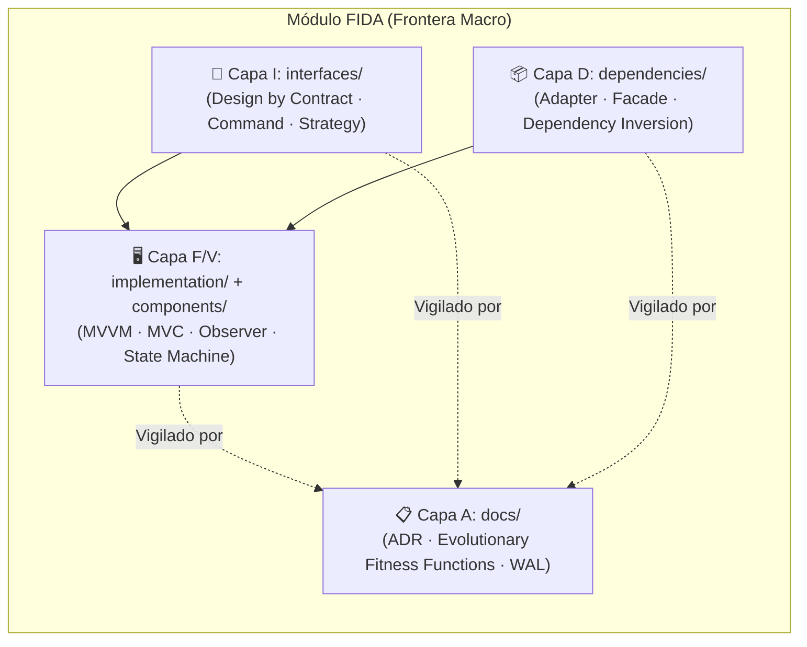
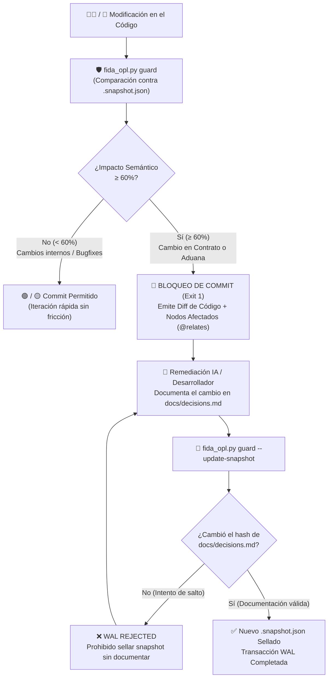

<div align="center">

# 🏛️ Arquitectura FIDA + OPL

### **F**eature/View · **I**nterface · **D**ependencies · **A**rtifacts
*Macro-arquitectura modular, evolutiva y defensiva con **Write-Ahead Logging (WAL) Documental** para la era del desarrollo asistido por Inteligencia Artificial.*

[-3776AB?style=for-the-badge&logo=python&logoColor=white)](#)
[](#)
[](#)
[](#)
[](#)

</div>

---

## 📖 Manifiesto: ¿Por qué existe FIDA?

Durante décadas, los patrones clásicos (**MVC**, **MVVM**, **MVP**) resolvieron cómo separar la vista de los datos, pero dejaron sin resolver tres problemas estructurales que hoy —en la era del código generado por IA— se han vuelto críticos:

1. **La "Sopa de Dependencias" y los Archivos Monstruo**: Agrupar por capas técnicas (`/views`, `/controllers`, `/models`) dispersa una misma funcionalidad por todo el repositorio. Cualquier archivo puede importar cualquier librería externa en cualquier momento, creando un acoplamiento invisible donde cambiar un componente global rompe pantallas en el otro extremo del sistema.
2. **La Fricción con la Inteligencia Artificial**: Los modelos de lenguaje (LLMs) alucinan y generan deuda técnica cuando operan sobre archivos masivos sin fronteras explícitas. Si no existen "raíles de tren" verificables por máquina, la IA resuelve el problema inmediato degradando la arquitectura a largo plazo.
3. **La Muerte Silenciosa de la Documentación**: En el desarrollo tradicional, la documentación es un ciudadano de segunda clase: el código cambia, el commit entra y el `.md` queda obsoleto para siempre.

> **La tesis de FIDA:**
> *La velocidad sin precisión es solo retrabajo diferido.*
> FIDA transforma cada funcionalidad en una **caja negra autocontenida** con contratos estrictos, una **aduana única de importaciones** verificada por linter y un sistema inmunológico (**OPL + Guardián WAL**) donde **ningún cambio estructural de código existe oficialmente hasta que su decisión arquitectónica ha sido documentada y validada criptográficamente**.

---

## 🧩 ¿Qué es FIDA? (Los 4 Pilares + 5 Subcarpetas)

**FIDA** es una **macro-arquitectura** (o *meta-patrón*). No compite con MVC, MVVM, Observer o Clean Architecture; **los envuelve**. Mientras que MVVM define cómo fluyen los datos dentro de una pantalla, FIDA define las fronteras físicas, los contratos públicos, las aduanas de conexión con el mundo exterior y la auditoría evolutiva del módulo.

```text
               ┌────────────────────────────────────────────────────────┐
               │                      MÓDULO FIDA                       │
               │                                                        │
  [EXTERIOR]──►│  I — Interface     (/interfaces)    Diagrama de Pines  │
               │  D — Dependencies  (/dependencies)  Aduana / Enchufes  │
               │  F/V — View        (/implementation) Circuito Visual   │
               │  C — Components    (/components)    Piezas Locales     │
               │  A — Artifacts     (/docs)          Datasheet + WAL    │
               └────────────────────────────────────────────────────────┘
```

### Anatomía de un Módulo FIDA Escalable

A diferencia de los enfoques minimalistas que empiezan con archivos sueltos y terminan en carpetas caóticas cuando el proyecto crece, FIDA establece **5 subcarpetas desde el día 1** para garantizar que cada módulo escale sin necesidad de reestructuraciones futuras:

```text
src/features/HomeView/
├── interfaces/
│   └── IHomeView.ts              # 📜 (I) Contrato público: Props, Events y Tipos exportados
├── dependencies/
│   └── dependencies.ts           # 📦 (D) La Aduana: Único punto de entrada para librerías/servicios externos
├── implementation/
│   └── HomeView.view.tsx         # 🖥️ (F/V) Implementación visual (puede usar MVVM/MVC internamente)
├── components/
│   └── README.md                 # 🧱 Subcomponentes exclusivos de esta vista (prohibido usarlos fuera)
└── docs/
    ├── decisions.md              # 📋 (A) Registro de Decisiones Arquitectónicas (ADR)
    ├── fida.module.json          # 🗂️ (A) Manifiesto modular auto-sincronizado
    └── .snapshot.json            # 🔒 (A) Foto estructural y hash criptográfico WAL
```

| Pilar | Subcarpeta | Responsabilidad | Regla del Guardián (`check --strict`) |
| :---: | :--- | :--- | :--- |
| **I** | `interfaces/` | Define **qué hace** el módulo (datos de entrada y eventos de salida) antes de escribir cómo se ve. | `fida/interface-no-implementation`: Prohibido incluir clases, funciones con cuerpo o lógica ejecutable. |
| **D** | `dependencies/` | Actúa como la **Aduana** del módulo. Importa y reexporta todo recurso externo que la vista necesite. | `fida/no-unused-dependencies`: Prohibido acumular exportaciones huérfanas que la vista ya no utilice. |
| **F / V** | `implementation/` | Renderiza la UI y coordina el estado local obedeciendo el contrato de `interfaces/`. | `fida/view-imports-through-gateway`: Prohibido importar paquetes o rutas externas sin pasar por `dependencies/`. |
| **C** | `components/` | Aloja subcomponentes privados exclusivos de esta vista. Si se reutilizan en otra vista, se promueven a `shared/`. | Sujeto a la misma regla estricta de Aduana que `implementation/`. |
| **A** | `docs/` | Conserva la memoria viva del módulo: `decisions.md`, manifiesto modular y snapshot WAL. | Protegido por hash criptográfico: bloquea commits con impacto $\ge 60\%$ si no se actualiza `decisions.md`. |

---

## 🔄 Ortogonalidad: Cómo FIDA Coexiste con Otros Patrones

FIDA gobierna el **empaquetado macro**; tú eliges el **micro-patrón** interno según la complejidad de cada pantalla:



* **Pantallas simples** (ej. *Acerca de*, *Términos*): Implementación directa y pasiva dentro de `implementation/`.
* **Pantallas complejas** (ej. *Reproductor Multimedia*, *Dashboard Financiero*): Puedes implementar **MVVM** (`ViewModel` + `StateFlow`/`Signals`), **MVC** o **Máquinas de Estado** dentro de `implementation/` sin que el resto de la aplicación se entere. Si mañana decides reescribir la lógica interna de MVVM a otro patrón, el contrato (`interfaces/`) y la aduana (`dependencies/`) permanecen intactos.

---

## 🛡️ El Sistema Inmunológico: WAL Documental y Radio de Impacto

La innovación central de **FIDA + OPL** es tratar la documentación como un **Write-Ahead Log (WAL)** de base de datos: **una transacción de código con impacto estructural no puede confirmarse hasta que su registro documental ha sido escrito y verificado**.



### Algoritmo de Puntuación Semántica por Radio de Efecto

Medir cambios por porcentaje de líneas de texto (`git diff` plano) es engañoso: formatear un archivo cambia el 40% del texto con **0% de impacto arquitectónico**, mientras que cambiar una sola línea en un `import` o en un tipo de interfaz es el 1% del texto pero tiene **100% de impacto estructural**.

El motor `fida_opl.py guard` evalúa el impacto en **3 niveles jerárquicos**:

| Nivel | Capa / Cambio Detectado | Peso WAL | Justificación Arquitectónica |
| :---: | :--- | :---: | :--- |
| **Nivel 1**<br>*(Estructural)* | Modificación en `interfaces/` (`@kind(interface)`) | **+60%** | Altera el contrato público del módulo. Dispara bloqueo inmediato y revisión obligatoria. |
| **Nivel 1**<br>*(Frontera)* | Adición/eliminación en `dependencies/` (`@kind(dependencies)`) | **+40%** c/u | Altera el acoplamiento del módulo con el exterior. |
| **Nivel 2**<br>*(Comportamiento)* | Función o componente creado/eliminado en `implementation/` o `components/` | **+15%** c/u | Modifica la estructura interna del módulo. Acumulativo. |
| **Nivel 3**<br>*(Implementación)* | Diferencia de **caracteres limpios** (sin espacios, tabs ni saltos de línea) `< 50 chars` | **+2%** | Inmune al auto-formateador (Prettier/Black). Permite arreglar bugs o estilos sin fricción. |
| **Nivel 3**<br>*(Implementación)* | Diferencia de **caracteres limpios** $\ge 50\text{ chars}$ | **+10%** | Refactorización interna moderada. |

---

## 🔗 Grafo Relacional OPL (`@pca:start`) y Manifiestos Híbridos

Cada archivo gobernado por el kit posee en su cabecera una ficha estructural compacta que permite a humanos y agentes de IA entender el archivo **sin leer toda su implementación**:

```typescript
// @pca:start
// @id(feature.homeview.view)
// @kind(view)
// @limit(lines: 300)
// @contract(HomeView(props: HomeViewContract))
// @relates(feature.homeview.interface)
// @relates(feature.homeview.dependencies)
// @desc(Implementación visual principal del módulo HomeView)
// @pca:end
```

### Lo Mejor de Ambos Mundos: Manifiesto Modular + Autodiscovery (`sync` & `bootstrap`)
Para evitar que el archivo de configuración del proyecto se convierta en un JSON inmanejable de miles de líneas:
1. **Descentralización Modular**: Cada módulo FIDA guarda su propio inventario en `docs/fida.module.json`.
2. **Autodiscovery Inteligente (`bootstrap --apply`)**: Escanea el proyecto respetando `.fidaignore`, detecta archivos nuevos sin cabecera, **extrae automáticamente sus funciones/tipos exportados (`@contract`) y sus imports locales (`@relates`)**, e inyecta la plantilla base sin intervención manual.
3. **Sincronización en 1 Comando (`sync`)**: Lee las cabeceras y los imports reales de todos los archivos, actualiza cada `docs/fida.module.json` y mantiene sincronizado el índice raíz `fida.config.json`.

---

## 🛠️ Referencia Completa de `fida_opl.py`

El motor está escrito en **Python 3.9+ utilizando exclusivamente la biblioteca estándar** (cero `pip install`, cero `node_modules` requeridos para operar).

```bash
# 1. Instalar FIDA + OPL en cualquier proyecto nuevo (crea .fidaignore, fida.config.json, AGENTS.md y hook Git)
python3 fida-kit/tools/fida_opl.py install-project

# 2. Crear un módulo FIDA con sus 5 subcarpetas (soporta: ts, js, py, kt, rs)
python3 fida-kit/tools/fida_opl.py init HomeView --lang ts --dest src/features

# 3. Auto-inyectar cabeceras @pca:start en archivos existentes del proyecto (respeta .fidaignore)
python3 fida-kit/tools/fida_opl.py bootstrap --apply

# 4. Sincronizar manifiestos modulares (docs/fida.module.json) e índice central (fida.config.json)
python3 fida-kit/tools/fida_opl.py sync

# 5. Validar límites de líneas (@limit), relaciones (@relates), aduanas FIDA y dependencias huérfanas
python3 fida-kit/tools/fida_opl.py check --strict

# 6. Ejecutar el Guardián WAL (compara código vs snapshot, muestra diff real y bloquea si Score >= 60%)
python3 fida-kit/tools/fida_opl.py guard

# 7. Confirmar transacción WAL tras documentar en docs/decisions.md (verifica hash criptográfico)
python3 fida-kit/tools/fida_opl.py guard --update-snapshot

# 8. Analizar qué módulos se romperían si modificas un nodo (impacto directo y transitivo)
python3 fida-kit/tools/fida_opl.py impact feature.homeview.interface --transitive

# 9. Generar el grafo arquitectónico completo en JSON y Mermaid (grafo.json + grafo.mmd)
python3 fida-kit/tools/fida_opl.py graph

# 10. Ejecutar las 10 suites de pruebas doradas de autodiagnóstico
python3 fida-kit/tools/fida_opl.py selftest
```

> 💡 **Consumo para Agentes de IA**: Todos los comandos soportan el flag `--json` (`python3 fida-kit/tools/fida_opl.py --json check --strict`) para entregar salidas estructuradas deterministas a cualquier LLM o pipeline CI/CD.

---

## 💻 Ejemplo Práctico de los 3 Archivos de Código de un Módulo

### 1. El Contrato (`interfaces/IHomeView.ts`)
```typescript
export interface IHomeViewProps {
  userName: string;
  isAuthenticated: boolean;
}

export interface IHomeViewEvents {
  onLogout: () => void;
}

export type HomeViewContract = IHomeViewProps & IHomeViewEvents;
```

### 2. La Aduana (`dependencies/dependencies.ts`)
```typescript
// Reexporta el contrato propio y actúa como única puerta hacia el exterior
export type { HomeViewContract } from "../interfaces/IHomeView";

// Si mañana cambia la librería global de UI, solo se edita esta línea en todo el módulo:
export { Button } from "@/shared/ui/Button";
```

### 3. La Implementación (`implementation/HomeView.view.tsx`)
```tsx
// La vista SOLO conoce su aduana. Prohibido importar de '@/shared/...' directamente.
import type { HomeViewContract } from "../dependencies/dependencies";
import { Button } from "../dependencies/dependencies";

export const HomeView = ({ userName, onLogout }: HomeViewContract) => {
  return (
    <section>
      <h1>Bienvenido, {userName}</h1>
      <Button onClick={onLogout}>Cerrar Sesión</Button>
    </section>
  );
};
```

---

## 📦 Estructura de este Repositorio (`fida-kit/`)

```text
fida-kit/
├── README.md                        # Este documento de especificación y arquitectura
├── AGENTS.md                        # Directrices estrictas para Agentes de IA (Cursor, Claude, Antigravity, etc.)
├── .fidaignore                      # Reglas de exclusión declarativa (estilo .gitignore)
├── fida.config.json                 # Índice central auto-sincronizado
├── package.json                     # Soporte opcional para análisis AST profundo con ts-morph
│
├── tools/                           # Motor principal FIDA + OPL (Python 3.9+ puro, 0 dependencias)
│   ├── fida_opl.py                  # CLI unificada (10 subcomandos)
│   ├── fida_opl_core.py             # Parser de paréntesis balanceados, .fidaignore, bloques y grafo
│   ├── fida_opl_guard.py            # Bootstrap, sync híbrido, linter de aduanas y Guardián WAL
│   ├── fida_opl_templates.py        # Generador multi-lenguaje (ts, js, py, kt, rs) e instalador
│   └── fida_opl_selftest.py         # Suite de 10 pruebas doradas en directorios temporales
│
├── templates/module/                # Plantilla canónica de las 5 subcarpetas FIDA
├── examples/HomeView/               # Módulo de referencia completo y funcional
├── scripts/                         # Hooks de Git (pre-commit) y wrappers CLI
└── eslint/fida-boundaries.js        # Reglas ESLint complementarias para entornos JS/TS
```

---

## ⚡ Adopción en 60 Segundos en Cualquier Proyecto

1. **Copia `fida-kit/`** dentro de tu repositorio.
2. **Ejecuta el instalador automático**:
   ```bash
   python3 fida-kit/tools/fida_opl.py install-project
   ```
3. **Si el proyecto ya tiene código**, inyecta las anotaciones base automáticamente:
   ```bash
   python3 fida-kit/tools/fida_opl.py bootstrap --apply
   ```
4. **Crea tu primer módulo FIDA**:
   ```bash
   python3 fida-kit/tools/fida_opl.py init MiModulo --lang ts
   ```

---

<div align="center">

**Diseñado bajo la premisa de que el software profesional no se mide por qué tan rápido se escribe la primera vez, sino por qué tan imposible es degradarlo con el tiempo.**

</div>
